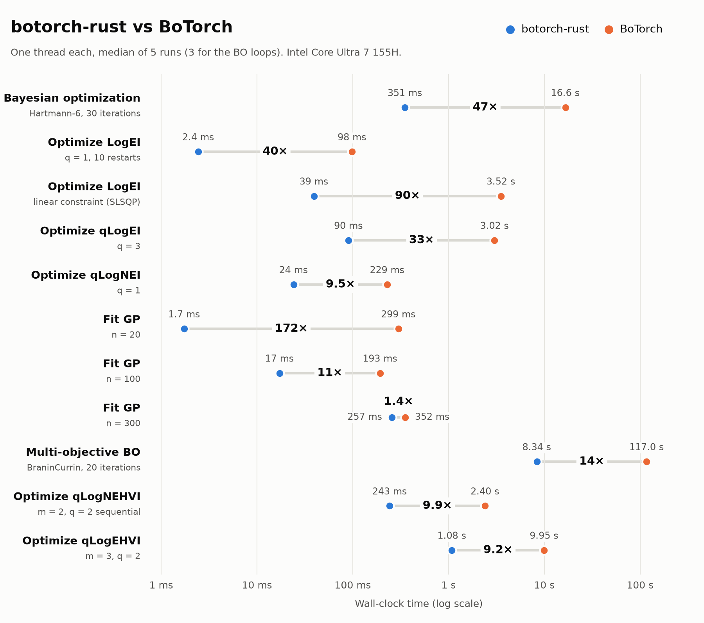

# botorch-rust

*botorch-rust* is a fast implementation of [BoTorch](https://botorch.org) in
Rust, with Python bindings that follow BoTorch's API for the supported features.
It is an independent project, not affiliated with or endorsed by Meta or the
BoTorch team.

## Why botorch-rust?

### Speed

Bayesian optimization usually works with a few dozen to a few hundred
observations. At that scale BoTorch's run time is dominated by overhead
rather than arithmetic: PyTorch dispatch and autograd bookkeeping for tiny
tensors, and Python-level loops around SciPy's optimizers. botorch-rust
evaluates the same mathematics natively in double precision, with analytic
gradients and multi-start optimizations running in parallel. A complete
30-iteration BO loop on Hartmann-6 (model fitting plus acquisition
optimization in every iteration) takes 351 ms instead of 16.6 s, a
`LogExpectedImprovement` optimization with 10 restarts 2.4 ms instead of
98 ms, and 20 iterations of multi-objective BO with qLogNEHVI 8.3 s instead of
117 s (single thread, see [Benchmarks](#benchmarks)). This makes BO practical inside tight
loops: many repetitions for benchmarking, cheap objective functions, or
interactive use.

<picture>
  <source media="(prefers-color-scheme: dark)" srcset="docs/assets/benchmark-dark.png">
  
</picture>

### No PyTorch dependency

The Python package `botorch_rs` has no runtime dependencies, not even NumPy.
Arrays may be torch tensors, NumPy arrays or nested lists of floats, and
results come back with the type of the corresponding input. The Rust crate
`botorch_core` can be used directly from Rust.

### The same API

Typical BoTorch code runs after changing the imports (GPyTorch's modules
that BoTorch users touch, such as `gpytorch.mlls`, live in `botorch_rs` too):

```python
import torch
from botorch_rs.models import SingleTaskGP
from botorch_rs.models.transforms import Normalize, Standardize
from botorch_rs.mlls import ExactMarginalLogLikelihood   # gpytorch.mlls in BoTorch
from botorch_rs.fit import fit_gpytorch_mll
from botorch_rs.acquisition import LogExpectedImprovement
from botorch_rs.optim import optimize_acqf
from botorch_rs.test_functions import Hartmann

problem = Hartmann(dim=6, negate=True)
train_X = torch.rand(20, 6, dtype=torch.float64)
train_Y = problem(train_X).unsqueeze(-1)
model = SingleTaskGP(train_X, train_Y, input_transform=Normalize(d=6),
                     outcome_transform=Standardize(m=1))
mll = ExactMarginalLogLikelihood(model.likelihood, model)
fit_gpytorch_mll(mll)
acqf = LogExpectedImprovement(model, best_f=train_Y.max())
candidate, value = optimize_acqf(acqf, bounds=problem.bounds, q=1,
                                 num_restarts=10, raw_samples=512)
```

## Design philosophy

Like [Rustuna](https://github.com/optuna/rustuna) for Optuna, botorch-rust
balances compatibility and performance:

- **Essentially the same API.** Module paths, class names, argument names,
  order and defaults follow BoTorch. Unsupported combinations raise
  `botorch_rs.exceptions.UnsupportedError`, a `NotImplementedError`, instead
  of silently ignoring it.
- **Numerical parity.** Supported operations are compared with BoTorch itself:
  identical data and hyperparameters give matching posteriors, marginal
  likelihoods and acquisition values to about 1e-10, except documented upstream
  correctness fixes and numerical conventions (see
  [Equivalence with BoTorch](#equivalence-with-botorch)).
- **Not a complete replacement yet.** botorch-rust covers exact GPs
  (single- and multi-output, batched, model lists, multi-task, multi-fidelity,
  mixed, MAP SAAS and ensembles), fully Bayesian GPs with native NUTS,
  variational and higher-order GPs, preference learning, the single- and
  multi-objective acquisition functions, and acquisition optimization.
  Specialized configurations, GPU execution and remaining
  hyperparameter-gradient configurations are listed below. Public-name
  coverage and numerical parity are tracked separately.

## Installation

### Python

```console
$ pip install botorch-rust
```

[PyPI](https://pypi.org/project/botorch-rust/) has prebuilt abi3 wheels for
CPython 3.11 and later: Windows x86_64, macOS arm64 and x86_64, and Linux x86_64
and aarch64. They need no Rust toolchain. The wheels are also attached to the
[GitHub releases](https://github.com/M-Colley/botorch-rust/releases).

From a source checkout (requires a Rust toolchain, see [rustup.rs](https://rustup.rs)):

```console
$ pip install ./botorch_pyo3
```

This builds an abi3 wheel with [maturin](https://www.maturin.rs). For development, `python scripts/develop.py` builds the
extension into the source tree instead (see [Development](#development)).

### Rust

```toml
[dependencies]
botorch_core = { git = "https://github.com/M-Colley/botorch-rust", tag = "v0.2.0" }
```

## Quickstart

### Python

A Bayesian optimization loop with batch acquisition (`q = 2`) and the noisy
LogEI acquisition function; all arrays are torch tensors here, but NumPy
arrays or nested lists work the same way:

```python
import torch
from botorch_rs.acquisition import qLogNoisyExpectedImprovement
from botorch_rs.fit import fit_gpytorch_mll
from botorch_rs.mlls import ExactMarginalLogLikelihood
from botorch_rs.models import SingleTaskGP
from botorch_rs.models.transforms import Normalize
from botorch_rs.optim import optimize_acqf
from botorch_rs.sampling import SobolQMCNormalSampler
from botorch_rs.test_functions import Branin
from botorch_rs.utils.sampling import draw_sobol_samples

problem = Branin(negate=True, noise_std=0.1)
bounds = problem.bounds
train_X = draw_sobol_samples(bounds, n=8, q=1, seed=0).squeeze(-2)
train_Y = problem(train_X).unsqueeze(-1)
for iteration in range(10):
    model = SingleTaskGP(train_X, train_Y, input_transform=Normalize(d=2))
    fit_gpytorch_mll(ExactMarginalLogLikelihood(model.likelihood, model))
    acqf = qLogNoisyExpectedImprovement(
        model, X_baseline=train_X, sampler=SobolQMCNormalSampler(torch.Size([256]), seed=iteration)
    )
    candidates, _ = optimize_acqf(acqf, bounds, q=2, num_restarts=10, raw_samples=256,
                                  options={"seed": iteration})
    train_X = torch.cat([train_X, candidates])
    train_Y = torch.cat([train_Y, problem(candidates).unsqueeze(-1)])

posterior = model.posterior(train_X)
print(posterior.mean.shape, posterior.variance.shape)  # (28, 1), (28, 1)
```

Multi-objective optimization works the same way. This is BoTorch's qLogNEHVI
loop on BraninCurrin, which reaches about 93% of the maximum hypervolume in
10 iterations and about 9 seconds:

```python
import torch
from botorch_rs.acquisition.multi_objective import qLogNoisyExpectedHypervolumeImprovement
from botorch_rs.fit import fit_gpytorch_mll
from botorch_rs.mlls import ExactMarginalLogLikelihood
from botorch_rs.models import SingleTaskGP
from botorch_rs.models.transforms import Normalize
from botorch_rs.optim import optimize_acqf
from botorch_rs.sampling import SobolQMCNormalSampler
from botorch_rs.test_functions import BraninCurrin
from botorch_rs.utils.multi_objective.box_decompositions import DominatedPartitioning
from botorch_rs.utils.sampling import draw_sobol_samples

problem = BraninCurrin(negate=True)
bounds = problem.bounds
train_X = draw_sobol_samples(bounds, n=6, q=1, seed=0).squeeze(-2)
train_Y = problem(train_X)
for iteration in range(10):
    model = SingleTaskGP(train_X, train_Y, input_transform=Normalize(d=2))
    fit_gpytorch_mll(ExactMarginalLogLikelihood(model.likelihood, model))
    acqf = qLogNoisyExpectedHypervolumeImprovement(
        model, ref_point=problem.ref_point, X_baseline=train_X, prune_baseline=True,
        sampler=SobolQMCNormalSampler(torch.Size([128]), seed=iteration),
    )
    candidates, _ = optimize_acqf(acqf, bounds, q=2, num_restarts=10, raw_samples=512,
                                  sequential=True, options={"seed": iteration})
    train_X = torch.cat([train_X, candidates])
    train_Y = torch.cat([train_Y, problem(candidates)])

hv = DominatedPartitioning(ref_point=problem.ref_point, Y=train_Y).compute_hypervolume()
print(f"hypervolume {hv.item():.2f} of {problem.max_hv:.2f}")  # 55.13 of 59.41
```

As in BoTorch, L-BFGS-B sometimes stops with an abnormal line search on
qLogNEHVI's flat landscape. `optimize_acqf` then warns and retries with new
initial conditions. Over six runs of this loop, the first attempt failed in
22 of 60 calls with botorch-rust and 19 of 60 with BoTorch, and the final
hypervolumes were 55.7 and 55.9 on average.

### Rust

```rust
use std::sync::Arc;

use botorch_core::acquisition::LogExpectedImprovement;
use botorch_core::optim::{optimize_acqf, OptimizeAcqfOptions};
use botorch_core::{fit_gpytorch_mll, FitOptions, Matrix, Model, SingleTaskGP, SingleTaskGPOptions};

let train_x = Matrix::from_fn(12, 2, |i, j| ((i * 7 + j * 3) % 12) as f64 / 11.0);
let train_y = Matrix::from_fn(12, 1, |i, _| (6.0 * train_x[(i, 0)]).sin() + train_x[(i, 1)]);
let mut model = SingleTaskGP::new(train_x, train_y.clone(), SingleTaskGPOptions::default())?;
fit_gpytorch_mll(&mut model, FitOptions::default())?;

let model: Arc<dyn Model> = Arc::new(model);
let acqf = LogExpectedImprovement::new(model, train_y.max(), true)?;
let bounds = Matrix::from_row_slice(2, 2, &[0.0, 0.0, 1.0, 1.0]);
let options = OptimizeAcqfOptions { seed: Some(0), ..Default::default() };
let (candidate, value) = optimize_acqf(&acqf, &bounds, 1, 10, 512, &options)?;
```

`botorch_core/examples/bo_loop.rs` runs a complete loop on Hartmann-6
(`cargo run --release --example bo_loop`); the module documentation of
`botorch_core` (`cargo doc --open`) maps every BoTorch function to its Rust
counterpart.

## Supported API

| BoTorch / GPyTorch | botorch_rs | Notes |
|---|---|---|
| `botorch.models.SingleTaskGP` | `botorch_rs.models.SingleTaskGP` | `batch_shape x n x d` inputs and `batch_shape x n x m` targets (`m ≥ 1` independent outputs, any batch shape: independent hyperparameters per output and batch element, BoTorch's `_aug_batch_shape`); inferred noise or fixed `train_Yvar`; `posterior(X, output_indices, observation_noise, posterior_transform)` with BoTorch's shapes (`mean`/`variance` `batch x q x m`, `MultitaskMultivariateNormal` covariance `batch x qm x qm` in BoTorch's output-major layout, batch broadcasting, `rsample`, `rsample_from_base_samples`), `train_inputs`, `train_targets`, `named_parameters`, `initialize`, `likelihood.noise`, `covar_module.lengthscale`, ... |
| `botorch.models.ModelListGP` | `botorch_rs.models.ModelListGP` | independent single- or multi-output `SingleTaskGP`s (or `LCEMGP`s) with different training data; block-diagonal joint posterior over the concatenated outputs, `output_indices`, `posterior_transform`, `likelihood` (`LikelihoodList`), `named_parameters` |
| `botorch.models.contextual_multioutput.LCEMGP` | same path (also `botorch_rs.models`) | BoTorch's latent context embedding multi-output GP: learned embeddings (`embs_dim_list`, `torch.nn.Embedding(max_norm=1.0)` with its in-place renormalization) and fixed embeddings (`context_emb_feature`), `context_cat_feature`, `output_tasks`, `all_tasks` (also tasks without data); per-task constant means and noise levels, `Standardize`; `posterior` over the output tasks (`X` without the task column) or the given tasks (with it), batched, exact input gradients; `eval()` / `train()`, `named_parameters`, `initialize`, `emb_layers[i].weight`, `task_covar_module_base` (assignable), `_eval_context_covar()`; fitted with `fit_gpytorch_mll` and usable in every MC acquisition function and in a `ModelListGP`. Keyword-only `seed` for the embedding initialization. Differences: see the migration notes |
| the Unity project BOforUnity's provided-embedding LCE-M model (`_ProvidedEmbeddingLCEMGP`, not in BoTorch) | `botorch_rs.models.contextual_multioutput.ProvidedEmbeddingLCEMGP` (also `botorch_rs.models`) | botorch-rust extension, same signature as `LCEMGP` with `context_emb_feature` required: no learned embeddings; context covariance `(1 − w) · RBF(E, E) + w · I` on the provided embeddings `E` with a learned `w = context_specific_weight` (`Interval(0, 1, transform=None)`, initially 0); `HAS_PROVIDED_EMBEDDING_LCEMGP = True` in the same module |
| `botorch.models.MultiTaskGP` | `botorch_rs.models.MultiTaskGP` | Long-format data, `task_feature` (any column, negative allowed), `output_tasks`, `all_tasks` (tasks without data: `eval()` sets their task factors to the observed mean, as BoTorch), `rank`, `task_covar_prior` (default `BetaPrior(2.5, 1.5)` on the `PositiveIndexKernel` correlations as in BoTorch main; any prior, incl. `LKJCovariancePrior`, or `None`), `covar_module` (any botorch_rs kernel tree; `active_dims` relative to all columns, default the non-task columns), `mean_module` (`None` = per-task `MultitaskMean`, or a shared `ConstantMean`), `likelihood` (`HadamardGaussianLikelihood` or a shared `GaussianLikelihood`), `train_Yvar` (fixed noise), `outcome_transform` (`Standardize(m=1)` default, `None`), `input_transform` (`Normalize`, also with `indices`), `validate_task_values`. `posterior` over the output tasks (X without the task column; `output_indices` = other task values) or single-output (X with the task column), batched, `observation_noise=True`, `posterior_transform`; `condition_on_observations` (incl. `noise`, batched/broadcast), `fantasize`, `construct_inputs` (`SupervisedDataset`, `MultiTaskDataset`, `prior_config`, `map_heterogeneous_to_full`), `get_all_tasks`, `named_parameters` / `initialize` / `deepcopy`, fits (`fit_gpytorch_mll`), the analytic and MC acquisition functions (single- and multi-objective, compared: qLogNEI, qEI, qUCB, qSimpleRegret, LogEI, PosteriorMean, PosteriorStandardDeviation, qLogNEHVI via `ModelListGP`), in `ModelListGP`. |
| `botorch.models.KroneckerMultiTaskGP` | `botorch_rs.models.KroneckerMultiTaskGP` | Block design; `data_covar_module` (any kernel tree), `rank`, `task_covar_prior` (default `LKJCovariancePrior(m, eta, sd_prior)`, keyword arguments `eta=1.5` and `sd_prior=SmoothedBoxPrior(e^-6, e^1.25, 0.05)`), `likelihood` / `likelihood_rank` (task noise covariance of rank `r`), `outcome_transform` (`Standardize(m)`; none by default as in BoTorch), `input_transform` (`Normalize`). Exact MLL and gradients, `posterior` (`MultitaskGPPosterior`), fits, acquisition functions (on the exact joint posterior). |
| `botorch.posteriors.MultitaskGPPosterior` | `botorch_rs.posteriors.MultitaskGPPosterior` | `mean`, `variance` (exact), `distribution` (interleaved, marginal variances as BoTorch), `base_sample_shape` (`(n + q) m + n m [+ q m]`), `batch_range`, `rsample`, `rsample_from_base_samples` (Matheron's rule; output-shaped base samples drive the first `q m` entries as in BoTorch). |
| `gpytorch.likelihoods.MultitaskGaussianLikelihood` | `botorch_rs.likelihoods.MultitaskGaussianLikelihood` | `num_tasks`, `rank` (0: `task_noises`, `>0`: `task_noise_covar_factor`), `noise_prior`, `noise_constraint`; global and task noise. |
| `gpytorch.likelihoods.HadamardGaussianLikelihood` | `botorch_rs.likelihoods.HadamardGaussianLikelihood` | Now constructible (`num_tasks`, `noise_prior`, `noise_constraint`, `task_feature_index`) and passable to `MultiTaskGP`. |
| `gpytorch.kernels.MultitaskKernel` | `botorch_rs.kernels.MultitaskKernel` | The covariance module of `KroneckerMultiTaskGP` (evaluable stand-alone on unbatched inputs). |
| `gpytorch.priors.SmoothedBoxPrior` | `botorch_rs.priors.SmoothedBoxPrior` | Scalar `a`, `b`, `sigma`. |
| `PositiveIndexKernel(task_prior=LKJCovariancePrior)` | same | An LKJ prior on the task covariance matrix. |
| `botorch.models.SingleTaskMultiFidelityGP` | same path (also `botorch_rs.models`) | `data_fidelities`, `iteration_fidelity`, `linear_truncated` (`LinearTruncatedFidelityKernel` with `nu`) or `False` (`ExponentialDecayKernel` × `DownsamplingKernel`s × base kernel), custom `covar_module`, `train_Yvar`, `m ≥ 1` outputs, `Normalize`, `Standardize`; `construct_inputs(training_data, fidelity_features)`; `subset_output`; fits, posteriors, conditioning and fantasies as for `SingleTaskGP`; `qMultiFidelityKnowledgeGradient`, `qMultiFidelityMaxValueEntropy` / `qMultiFidelityLowerBoundMaxValueEntropy` and `qMultiFidelityHypervolumeKnowledgeGradient` on it |
| `botorch.models.MixedSingleTaskGP` | same path (also `botorch_rs.models`) | `cat_dims` (negative indices too), `cont_kernel_factory`, BoTorch's kernel `ScaleKernel(K_cont + ScaleKernel(K_cat)) + ScaleKernel(K_cont · K_cat)` (or `ScaleKernel(K_cat)` for an all-categorical space), `CategoricalKernel` with `GreaterThan(1e-6)` lengthscales, `train_Yvar`, `m ≥ 1`; `construct_inputs(training_data, categorical_features)`; `optimize_acqf_mixed` and `optimize_acqf_mixed_alternating` |
| `botorch.models.map_saas.get_map_saas_model`, `add_saas_prior`, `SaasPriorHelper`, `get_additive_map_saas_covar_module`, `get_mean_module_with_normal_prior`, `get_gaussian_likelihood_with_gamma_prior` | `botorch_rs.models.map_saas.*` (`add_saas_prior` also in `botorch_rs.models`) | half-Cauchy SAAS prior on `tau / lengthscale²`, fixed `tau` (float or tensor; a Python float is stored in float32, as in BoTorch) or learned `raw_tau` (`LogTransformedInterval(1e-3, 10, initial_value=0.1)` with `HalfCauchyPrior(0.1)`), BoTorch's `EPS = 1e-8` clamps; `NormalPrior(0, 1)` constant mean, `GammaPrior(0.9, 10)` noise with `LogTransformedInterval(1e-4, 1, initial_value=1e-2)` |
| `botorch.models.map_saas.AdditiveMapSaasSingleTaskGP` | same path (also `botorch_rs.models`) | sum of `num_taus` SAAS kernels with taus drawn as BoTorch does (torch's global generator) |
| `botorch.models.map_saas.EnsembleMapSaasSingleTaskGP` | same path (also `botorch_rs.models`) | batch of `num_taus` SAAS models (`taus`), `_is_ensemble`, `posterior` → `GaussianMixturePosterior` (`mixture_mean`, `mixture_variance`, `mixture_covariance_matrix`, `quantile`), `construct_inputs(num_taus)`; analytic and MC acquisition functions averaged over the members (`average_over_ensemble_models`), `prune_inferior_points` |
| `botorch.models.deterministic.AffineDeterministicModel` | same path (also `botorch_rs.models`) | `b + X a`; BoTorch's errors; `b` from a Python float is float32 as in BoTorch; usable as the model of acquisition functions (Rust model with analytic gradients) |
| `botorch.models.deterministic.FixedSingleSampleModel` | same path | `mean + sqrt(variance + jitter) · w` of a botorch_rs acquisition model (e.g. a `SingleTaskGP`), `w` from `torch.randn` by default; usable as the model of acquisition functions |
| `botorch.models.ensemble.EnsembleModel` | same path | abstract `forward` (torch); `posterior` → `EnsemblePosterior`; MC acquisition functions with an `IndexSampler` (members evaluated through `forward` with `torch.autograd` gradients); analytic acquisition functions on the mean and variance of the `EnsemblePosterior` (`ExpectedImprovement`, `LogExpectedImprovement`, `ProbabilityOfImprovement`, `LogProbabilityOfImprovement`, `UpperConfidenceBound`, `PosteriorMean`, `PosteriorStandardDeviation`, `ConstrainedExpectedImprovement`, `LogConstrainedExpectedImprovement`, `LogProbabilityOfFeasibility`). Acquisition functions need the attribute `dim` (botorch_rs extension) |
| `botorch.posteriors.ensemble.EnsemblePosterior`, `botorch.posteriors.fully_bayesian.GaussianMixturePosterior`, `botorch.posteriors.posterior_list.PosteriorList` | same paths (`PosteriorList` also in `botorch_rs.posteriors`) | weights, mixture moments, `rsample`, `rsample_from_base_samples`, quantiles (`batched_bisect`) |
| `botorch.sampling.index_sampler.IndexSampler` | same path | draws the member indices from torch's generator seeded with `seed` (the same draws as BoTorch) |
| `botorch.models.model.ModelList`, `ModelDict`, `FantasizeMixin` | same paths (`ModelList` also in `botorch_rs.models`) | `ModelList` of botorch_rs models (GPs and deterministic models): `posterior` (`PosteriorList`), `batch_shape`, `num_outputs`, `subset_output`, `transform_inputs`, `fantasize` (per sub-model), acquisition functions on the joint model; `ModelDict` with BoTorch's `InputDataError` |
| `Model.subset_output`, `Model.construct_inputs` | same names | `subset_output` for `SingleTaskGP` (any covariance module), `SingleTaskMultiFidelityGP`, `MixedSingleTaskGP`, the MAP SAAS models, `ModelListGP`, `ModelList`, the deterministic models; `construct_inputs` for every model above with BoTorch's or botorch_rs's `SupervisedDataset` |
| `botorch.utils.datasets.SupervisedDataset` | same path | `X`, `Y`, `Yvar`, names, validation, `clone`, equality |
| `botorch.models.additive_gp.OrthogonalAdditiveGP` | same path (not exported from `botorch_rs.models`, as in BoTorch) | `SingleTaskGP` with an `OrthogonalAdditiveKernel` (first and second order); `posterior(..., infer_all_components=True)` raises `UnsupportedError` |
| `botorch.models.PairwiseGP` | `botorch_rs.models.PairwiseGP` | `likelihood`, `covar_module` (any `ScaleKernel` tree), `input_transform` (without learned parameters), `jitter`, `xtol`, `consolidate_rtol` / `consolidate_atol`, `maxfev`; batched data; prior-only models; `posterior`, `condition_on_observations`, `fantasize` (pairwise samplers), `set_train_data`, `load_state_dict`, `construct_inputs` (BoTorch's `RankingDataset`), BoTorch's buffers (`utility`, `covar`, `covar_chol`, `covar_inv`, `likelihood_hess`, `hlcov_eye`, `D`, `DT`, `_x0`, ...) |
| `botorch.models.pairwise_gp.PairwiseLaplaceMarginalLogLikelihood` | `botorch_rs.models.PairwiseLaplaceMarginalLogLikelihood` | `mll(model(datapoints), comparisons)` or `mll()`; `value_and_grad(raw)` (botorch_rs extension: BoTorch's autograd gradient, computed natively) |
| `botorch.fit.fit_gpytorch_mll` (Laplace MLL) | `botorch_rs.fit.fit_gpytorch_mll` | L-BFGS-B with retries from prior samples, every evaluation warm-started like BoTorch's training forward pass |
| `botorch.models.likelihoods.pairwise.PairwiseLikelihood`, `PairwiseProbitLikelihood`, `PairwiseLogitLikelihood` | `botorch_rs.models.likelihoods.pairwise.*` | `p`, `log_p`, `negative_log_gradient_sum`, `negative_log_hessian_sum` (evaluated in Rust, not differentiable with torch), `forward` (a torch `Bernoulli`) |
| `botorch.acquisition.preference.AnalyticExpectedUtilityOfBestOption` | `botorch_rs.acquisition.preference.AnalyticExpectedUtilityOfBestOption` | `outcome_model` (a deterministic botorch_rs model), `previous_winner`; exact input gradients |
| `botorch.acquisition.preference.qExpectedUtilityOfBestOption` | `botorch_rs.acquisition.preference.qExpectedUtilityOfBestOption` | `outcome_model`, `sampler`, `objective`, `posterior_transform`, `X_pending` |
| `botorch.acquisition.preference.PairwiseBayesianActiveLearningByDisagreement` | `botorch_rs.acquisition.preference.PairwiseBayesianActiveLearningByDisagreement` | `outcome_model`, `num_samples`, `std_noise`; draws from the caller's array library (torch: BoTorch's draws for the same seed) |
| `botorch.acquisition.active_learning.PairwiseMCPosteriorVariance` | `botorch_rs.acquisition.active_learning.PairwiseMCPosteriorVariance` | any MC objective as link function |
| `botorch.acquisition.objective.LearnedObjective` | `botorch_rs.acquisition.objective.LearnedObjective` | `PairwiseGP` or deterministic `pref_model`, `sample_shape`, `seed`; native MC values and query derivatives, expanded preference samples, constraints and noisy improvement; [scope and joint-sampling correction](docs/learned-objective-acquisitions.md) |
| `botorch.sampling.pairwise_samplers.PairwiseMCSampler`, `PairwiseIIDNormalSampler`, `PairwiseSobolQMCNormalSampler` | `botorch_rs.sampling.pairwise_samplers.*` | `max_num_comparisons`, `seed` (numpy's choice of pairs); the preferred item first (BoTorch bug 1) |
| `botorch.sampling.normal.IIDNormalSampler` | `botorch_rs.sampling.IIDNormalSampler` | partial: sampling posteriors (torch's draws for `seed`), `batch_range_override`; not in MC acquisition functions |
| `PairwiseGP` in `ModelListGP` / `ModelList` | same | posteriors and acquisition functions; fits and fantasies raise BoTorch's errors |
| `botorch.acquisition.input_constructors.construct_inputs_analytic_eubo`, `construct_inputs_qeubo` | same path, registered for botorch_rs's EUBO / qEUBO | preferential BO (`model` is the preference model) and BOPE (`pref_model`; the outcome model becomes `FixedSingleSampleModel(model, w)`, `w = torch.randn(pref_model.dim) * sample_multiplier` from torch's global generator, Python's `random` without torch); `previous_winner`, `sampler`, `objective`, `posterior_transform`, `X_pending` |
| `PairwiseGP` with phase 8b's `SampleReducingMCAcquisitionFunction` subclasses | same | Python subclasses work on a `PairwiseGP`; `qMultiStepLookahead` raises BoTorch's `RuntimeError` |
| `botorch.models.transforms.input.Normalize` | same path | all arguments: `d`, `indices`, `bounds` (also batched), `batch_shape`, `transform_on_train/eval/fantasize`, `reverse`, `min_range`, `learn_bounds`, `almost_zero`, `center`; `bounds`, `offset`, `coefficient`, `learn_coefficients`, `get_init_args` (with `center` and unshifted bounds, meta-pytorch/botorch#3389), `equals`, `preprocess_transform`, `untransform` |
| `InputStandardize`, `AffineInputTransform`, `ReversibleInputTransform`, `InputTransform` | same paths | `indices`, `batch_shape`, flags, `reverse`, `min_std`; coefficients learned in train mode (BoTorch's `learn_coefficients`), fixed for `AffineInputTransform` |
| `Warp` | same path | Kumaraswamy CDF warping with learned `concentration0` / `concentration1` (`GreaterThan(1e-4)` without transform, optimizer bounds as BoTorch's), `concentration0_prior` / `concentration1_prior`, `indices`, `bounds`, `eps`, `batch_shape` (single-output batched models), flags; fitted jointly with the GP hyperparameters by `fit_gpytorch_mll` (exact gradients) |
| `Round` | same path | `integer_indices`, `categorical_features` (one-hot, rounded to the largest entry), `approximate` (BoTorch's `approximate_round` with `tau`), flags |
| `Log10` | same path | `indices`, `reverse`, flags |
| `AppendFeatures` | same path | `feature_set` or `f` (a torch callable with `indices`, `fkwargs`), `skip_expand`, flags; one-to-many (`n_f` points per input) in posteriors and Monte-Carlo acquisition functions (e.g. with risk measures); training inputs that already contain the feature columns (BoTorch's usual setup: the model's input dimension is then that of the posterior points) |
| `InteractionFeatures` | same path | `indices` (all dimensions by default) |
| `FilterFeatures` | same path | `feature_indices`, flags |
| `OneHotToNumeric`, `NumericToCategoricalEncoding` | same paths | `dim`, `categorical_features`, `encoders` (one-hot encoders evaluated natively, other callables through torch) |
| `LearnedFeatureImputation` | same path | `feature_indices`, `d`, `target_task`, `bounds` (BoTorch's `Interval` constraint on the raw values); learned imputation values fitted with the model |
| `ChainedInputTransform` | same path | any chain of the transforms above (keys, `equals`, `preprocess_transform`, `untransform`); steps in eval mode at construction (e.g. `get_rounding_input_transform`) as BoTorch |
| `BatchBroadcastedInputTransform` | same path | one chain per batch element of a batched model, `broadcast_index` |
| `botorch.models.transforms.outcome.Log`, `Power`, `Bilog` | same paths | `outputs` (some outputs only); `Log` transforms observation noise by the delta method, `Power` / `Bilog` raise BoTorch's `NotImplementedError`; `subset_output` re-indexes `outputs` as BoTorch main since meta-pytorch/botorch#3380; `untransform_posterior` gives a `TransformedPosterior` |
| `Standardize` | same path | `m`, `batch_shape`, `min_stdv`, `outputs` (some outputs only) and `subset_output` (meta-pytorch/botorch#3380) |
| `StratifiedStandardize` | same path | `stratification_idx`, `all_task_values`, `min_stdv` (strata without data or unknown values are not standardized, as BoTorch) |
| `ChainedOutcomeTransform`, `OutcomeTransform` | same paths | any chain of the outcome transforms above |
| `botorch.posteriors.TransformedPosterior`, `PosteriorList` | same paths | `mean` / `variance` (log-normal moments for `Log`; BoTorch's `NotImplementedError("No mean transform provided.")` for `Power` / `Bilog`), `rsample`, `rsample_from_base_samples`, `base_sample_shape` |
| `botorch.models.transforms.utils.*` | same path | `expand_and_copy_tensor`, `interaction_features`, `kumaraswamy_warp`, `inv_kumaraswamy_warp`, `nanstd`, `subset_transform`, `norm_to_lognorm`, `norm_to_lognorm_mean`, `norm_to_lognorm_variance`, `lognorm_to_norm` (native) |
| `botorch.models.transforms.factory.get_rounding_input_transform` | same path | `integer_indices`, `categorical_features`, `initialization`, `return_numeric`, `approximate` |
| `SingleTaskGP(input_transform=..., outcome_transform=...)` | same | every transform above (single- and multi-output, batched with `BatchBroadcastedInputTransform` / batched `Warp`); MLL and its exact gradient with respect to the learned transform parameters (with their priors); posteriors with and without observation noise; `condition_on_observations` and `fantasize` (fantasize mode skips steps with `transform_on_fantasize=False`, e.g. `InputPerturbation`, as BoTorch); analytic acquisition functions use the posterior moments, Monte-Carlo ones the transformed samples (exact gradients) |
| Monte-Carlo acquisition functions on transformed samples | same | t-batches whose samples are NaN (a `Power` transform whose inverse is undefined at negative base samples) have NaN values and gradients, as BoTorch's torch reductions give (`qExpectedImprovement`, `qProbabilityOfImprovement`, `qSimpleRegret`, `qUpperConfidenceBound`, `qLogExpectedImprovement`, `qNoisyExpectedImprovement`, `qLogNoisyExpectedImprovement`, ...) |
| `SingleTaskMultiFidelityGP`, `MixedSingleTaskGP`, `get_map_saas_model`, `AdditiveMapSaasSingleTaskGP`, `OrthogonalAdditiveGP` (phase 7b) with input and outcome transforms | same | every transform above (they are `SingleTaskGP`s in both libraries), e.g. `Warp` on the non-fidelity inputs, `Normalize(indices)` on the continuous inputs of a mixed model, `Log` / `Bilog` / `Power` outcomes; `subset_output` subsets general outcome transforms as BoTorch (`outcome_transform.subset_output`) |
| `ModelListGP` and `ModelList` with transformed sub-models | same | posterior a `PosteriorList` (as BoTorch) when a sub-model has a nonlinear outcome transform; `ScalarizedPosteriorTransform` moment-matches at `q = 1` (BoTorch's `scalarize_posterior` of a `PosteriorList`); Monte-Carlo acquisition functions sample every sub-model |
| `botorch.models.utils.gpytorch_modules.*` | `botorch_rs.models.utils.gpytorch_modules.*` | BoTorch's default (dimension-scaled LogNormal) and legacy (Gamma) priors |
| `gpytorch.kernels.RBFKernel` | `botorch_rs.kernels.RBFKernel` | ARD or a shared lengthscale, `active_dims`, `batch_shape`, any constraint / prior |
| `gpytorch.kernels.MaternKernel` | `botorch_rs.kernels.MaternKernel` | `nu` = 0.5, 1.5, 2.5 |
| `gpytorch.kernels.RQKernel` | `botorch_rs.kernels.RQKernel` | `alpha_constraint` |
| `gpytorch.kernels.PeriodicKernel` | `botorch_rs.kernels.PeriodicKernel` | ARD lengthscales and period lengths |
| `gpytorch.kernels.LinearKernel` | `botorch_rs.kernels.LinearKernel` | `variance` per dimension with `ard_num_dims` |
| `gpytorch.kernels.PolynomialKernel` | `botorch_rs.kernels.PolynomialKernel` | any `power` |
| `gpytorch.kernels.CosineKernel` | `botorch_rs.kernels.CosineKernel` | |
| `gpytorch.kernels.IndexKernel` | `botorch_rs.kernels.IndexKernel` | `rank`, `prior` (any univariate prior or `LKJCovariancePrior`); random `covar_factor` from torch's generator |
| `gpytorch.kernels.ScaleKernel` | `botorch_rs.kernels.ScaleKernel` | around any kernel |
| `gpytorch.kernels.AdditiveKernel`, `ProductKernel`, `k1 + k2`, `k1 * k2` | same names in `botorch_rs.kernels` | flattened like GPyTorch's `__add__` / `__mul__` |
| `gpytorch.kernels.Kernel.__call__` | `Kernel.__call__` | `k(x1, x2)`, `k(x1)`, `diag=True`; dense arrays of `x1`'s type |
| `botorch.models.kernels.CategoricalKernel` | `botorch_rs.models.kernels.CategoricalKernel` | |
| `botorch.models.kernels.DownsamplingKernel` | `botorch_rs.models.kernels.DownsamplingKernel` | `diag=True` deviates for several inputs (bug below) |
| `botorch.models.kernels.ExponentialDecayKernel` | `botorch_rs.models.kernels.ExponentialDecayKernel` | |
| `botorch.models.kernels.InfiniteWidthBNNKernel` | `botorch_rs.models.kernels.InfiniteWidthBNNKernel` | |
| `botorch.models.kernels.LinearTruncatedFidelityKernel` | `botorch_rs.models.kernels.LinearTruncatedFidelityKernel` | one or two fidelity dimensions, `nu` |
| `botorch.models.kernels.OrthogonalAdditiveKernel`, `leggauss` | `botorch_rs.models.kernels.OrthogonalAdditiveKernel`, `...orthogonal_additive_kernel.leggauss` | first and second order, `check_hypercube`, shared or per-dimension lengthscales |
| `botorch.models.kernels.PositiveIndexKernel` | `botorch_rs.models.kernels.PositiveIndexKernel` | `task_prior` on the correlations |
| `gpytorch.priors.LogNormalPrior`, `GammaPrior` | `botorch_rs.priors.*` | |
| `gpytorch.constraints.GreaterThan`, `Positive`, `Interval` | `botorch_rs.constraints.*` | softplus, sigmoid or no transform; `Interval(lower_bound, upper_bound, transform, inv_transform, initial_value)` as in GPyTorch (bounds and raw initial values in float32; with `transform=None` the value is the raw parameter, kept in `[l, u]` by `fit_gpytorch_mll`'s L-BFGS-B bounds); usable as lengthscale, outputscale and noise constraints. `GreaterThan` and `Positive` are subclasses of `Interval`, as in GPyTorch |
| `gpytorch.priors.NormalPrior`, `UniformPrior`, `HalfCauchyPrior`, `HalfNormalPrior` | `botorch_rs.priors.*` | parameters in torch's default dtype, like GPyTorch |
| `gpytorch.priors.LKJPrior`, `LKJCholeskyFactorPrior`, `LKJCovariancePrior` | `botorch_rs.priors.*` | `LKJCovariancePrior` as `IndexKernel(prior=...)` |
| `botorch.models.utils.priors.BetaPrior` | `botorch_rs.models.utils.priors.BetaPrior` | |
| `gpytorch.constraints.LessThan` | `botorch_rs.constraints.LessThan` | softplus or `transform=None` (optimizer bound) |
| `gpytorch.constraints.LogTransformedInterval`, `botorch.utils.constraints.LogTransformedInterval` / `NonTransformedInterval` | `botorch_rs.utils.constraints.*`, `botorch_rs.constraints` | raw = `log(value)`, raw bounds `(log lb, log ub)`, float32 bounds and initial raw value as in BoTorch |
| `gpytorch.means.ConstantMean(constant_prior, constant_constraint)` | `botorch_rs.means.ConstantMean` | priors on the constant (MLL term, gradient, prior sampling); non-enforced constraints only |
| `draw_matheron_paths`, `draw_kernel_feature_paths` with kernel trees | `botorch_rs.sampling.pathwise.*` | RBF and Matérn (any ν) with ARD or a shared lengthscale and `active_dims`, with or without `ScaleKernel`: the kernels BoTorch's pathwise sampling supports; others raise `NotImplementedError` like BoTorch |
| `gpytorch.likelihoods.GaussianLikelihood`, `gpytorch.means.ConstantMean` | `botorch_rs.likelihoods.*`, `botorch_rs.means.*` | |
| `gpytorch.likelihoods.HadamardGaussianLikelihood`, `gpytorch.means.MultitaskMean` | `botorch_rs.likelihoods.*`, `botorch_rs.means.*` | the per-task noise and means of an `LCEMGP` (`likelihood.noise`, `mean_module.base_means[t].constant`); not constructible on their own |
| `gpytorch.mlls.ExactMarginalLogLikelihood`, `SumMarginalLogLikelihood` | `botorch_rs.mlls.*` | `mll()` evaluates it on the training data (one value per output and batch element; the sum over a `ModelListGP`'s sub-models divided by their number) |
| `botorch.fit.fit_gpytorch_mll` | `botorch_rs.fit.fit_gpytorch_mll` | L-BFGS-B (port of L-BFGS-B 3.0 reproducing SciPy's iterates), retries from prior samples, `optimizer_kwargs={"options": {...}}`, `max_attempts`; multi-output and batched models are fitted per element like BoTorch's batched independent fitting, `ModelListGP`s per sub-model |
| `ExpectedImprovement`, `LogExpectedImprovement`, `ProbabilityOfImprovement`, `LogProbabilityOfImprovement`, `UpperConfidenceBound`, `PosteriorMean`, `PosteriorStandardDeviation` | `botorch_rs.acquisition.*` | analytic, `q = 1`, `maximize`, `posterior_transform` |
| `LogConstrainedExpectedImprovement`, `ConstrainedExpectedImprovement` | `botorch_rs.acquisition.*` | analytic, `objective_index`, `constraints={i: (lower, upper)}` (`None`: unbounded), `maximize` |
| `qExpectedImprovement`, `qProbabilityOfImprovement`, `qUpperConfidenceBound`, `qSimpleRegret`, `qLogExpectedImprovement`, `qLogNoisyExpectedImprovement` | `botorch_rs.acquisition.*` | any `q`, `X_pending` / `set_X_pending`, baseline pruning, `incremental`, `fat` (also a per-constraint list), `tau_max`, `tau_relu`, `posterior_transform`, `objective`; outcome `constraints` (callables, feasible iff `<= 0`) and `eta` (a float or one per constraint) for qEI, qPI, qLogEI and qLogNEI (feasibility-weighted incumbents and BoTorch's lower bound for infeasible baselines) |
| `qLogProbabilityOfFeasibility` | `botorch_rs.acquisition.qLogProbabilityOfFeasibility` | `constraints`, `eta`, `fat`, `tau_max`, `posterior_transform` |
| `botorch.acquisition.knowledge_gradient.qKnowledgeGradient` | same path (also `botorch_rs.acquisition`) | one-shot KG: fantasies of the candidates (and pending points) with the sampler's base samples (`SingleTaskGP`, single- and multi-output, `ModelListGP`), value function the posterior mean (through `posterior_transform`) or, with an MC `objective`, `qSimpleRegret` with `inner_sampler`; `current_value`, `X_pending`, `get_augmented_q_batch_size`, `extract_candidates`, `evaluate(X, bounds, num_restarts, raw_samples, options)` (inner maximization: `gen_value_function_initial_conditions` and one joint L-BFGS-B problem). Exact gradients also with MC objectives (BoTorch's are wrong, #3427) |
| `qMultiFidelityKnowledgeGradient`, `ProjectedAcquisitionFunction` | same path | `cost_aware_utility` (`InverseCostWeightedUtility`, `GenericCostAwareUtility`), `project` / `expand` (native for `functools.partial`s of `project_to_target_fidelity` / `expand_trace_observations`, else torch callables), `valfunc_cls` / `valfunc_argfac` for the native value functions `PosteriorMean`, `PosteriorStandardDeviation`, `UpperConfidenceBound`, `(Log)ExpectedImprovement`, `(Log)ProbabilityOfImprovement`, `ScalarizedPosteriorMean`, `qSimpleRegret`, `qExpectedImprovement`, `qProbabilityOfImprovement`, `qUpper/LowerConfidenceBound`, `qPosteriorStandardDeviation` |
| `botorch.optim.initializers.gen_one_shot_kg_initial_conditions` | `botorch_rs.optim.initializers` (also used by `optimize_acqf` for qKG / qMFKG) | `frac_random`, `num_inner_restarts`, `raw_inner_samples`, `eta`; fixed features and linear constraints |
| `botorch.acquisition.monte_carlo.qNoisyExpectedImprovement` | same path | `cache_root` (BoTorch's low-rank update of the cached baseline root with its base-sample layout), `prune_baseline`, `X_pending`, objectives, outcome `constraints` / `eta`, `X_baseline`; keyword-only `lower_bound_points` |
| `qLowerConfidenceBound`, `qPosteriorStandardDeviation` | same path | sample-reducing like `qUpperConfidenceBound` |
| `botorch.acquisition.analytic.NoisyExpectedImprovement`, `LogNoisyExpectedImprovement` | same path | noiseless fantasy models of a fixed-noise `SingleTaskGP` (BoTorch's `1e-7` noise); keyword-only `sampler` for explicit fantasy base samples; `best_f` of every fantasy |
| `LogProbabilityOfFeasibility`, `ScalarizedPosteriorMean` | same path | multi-output constraints `{i: (lower, upper)}`; `weights` of the `q` points |
| `qAnalyticProbabilityOfImprovement` | same path | MVNXPB (bivariate conditioning, GGE ordering, Genz's bivariate normal) ported step by step; exact gradients by forward-mode dual numbers through MVNXPB. Rust: `botorch_core::utils::mvnxpb::{bvn, bvnmom, mvnxpb_log_prob}` |
| `botorch.acquisition.max_value_entropy_search.qMaxValueEntropy`, `qLowerBoundMaxValueEntropy`, `qMultiFidelityMaxValueEntropy`, `qMultiFidelityLowerBoundMaxValueEntropy`, `MaxValueBase` | same path | Gumbel or Thompson max values over candidate set, training inputs and pending points; `posterior_max_values` (settable), fantasies of the pending points (qMES), GIBBON's repulsion; `num_fantasies`, `num_y_samples`, `use_gumbel`, `maximize`, `posterior_transform`, `train_inputs`, `cost_aware_utility`, `project`, `expand`. Keyword-only `seed`, `sampler`, `fantasies_sampler` |
| `_sample_max_value_Gumbel`, `_sample_max_value_Thompson` | same path | keyword-only `uniforms` / `base_samples` or `seed`; `batch_shape x n x d` candidate sets: `num_samples x batch_shape` max values (`num_samples x 1` unbatched) |
| `botorch.acquisition.joint_entropy_search.qJointEntropySearch` | same path | `"LB"` and `"MC"`, `condition_noiseless`, `posterior_transform`, `X_pending`, `num_samples` (keyword-only `sampler`); conditioning per optimum and output |
| `botorch.acquisition.predictive_entropy_search.qPredictiveEntropySearch` | same path | the multi-objective PES with one optimal input per sample; `ep_iterations`, `ep_damping`, `cached_factors` |
| `botorch.acquisition.utils.get_optimal_samples` | same path | Matheron paths optimized like `optimize_posterior_samples` (raw Sobol points, top-`num_restarts`, one joint L-BFGS-B problem, `maxiter=2000`); `posterior_transform` or `objective`, `return_transformed`; keyword-only `num_features`, `seed`, `draws`, `candidates`, `maxiter` |
| `botorch.acquisition.thompson_sampling.PathwiseThompsonSampling` | same path | `objective`, `posterior_transform`, `redraw(batch_size)`, `batch_size`, BoTorch's batch-size error; keyword-only `num_features`, `seed`, `redraw(..., draws=...)` |
| `botorch.acquisition.active_learning.qNegIntegratedPosteriorVariance` | same path | closed form of the variance after conditioning (no fantasies needed for exact GPs; `sampler` accepted), `posterior_transform`, `X_pending` |
| `botorch.acquisition.penalized.*` | same path | `L2Penalty`, `L1Penalty`, `GaussianPenalty`, `GroupLassoPenalty`, `L0Approximation`, `L0PenaltyApprox` (native in `PenalizedAcquisitionFunction`; BoTorch's own modules and other torch callables through torch), `L1PenaltyObjective`, `L0PenaltyApproxObjective`, `PenalizedMCObjective` (native, also BoTorch's), `group_lasso_regularizer`, `narrow_gaussian`, `nnz_approx` |
| `botorch.acquisition.proximal.ProximalAcquisitionFunction` | same path | `transformed_weighting`, `beta` (softplus), `Normalize` input transforms, `ModelListGP` with equal training inputs |
| `botorch.acquisition.fixed_feature.FixedFeatureAcquisitionFunction` | same path | values per fixed column or per point (`q x d_f`), `X_pending` setter, `_construct_X_full`; also t-batched values (`batch_shape x q x d_f`, broadcast against `X`); shared and per-point values stay native |
| `botorch.acquisition.input_constructors.acqf_input_constructor`, `get_acqf_input_constructor`, `allow_only_specific_variable_kwargs` | same path (`get_acqf_input_constructor` also in `botorch_rs.acquisition`) | the registry, keyed by the botorch_rs classes; every constructor accepts `training_data` as a `SupervisedDataset` of botorch_rs or BoTorch or a dict of them (block designs), objectives, posterior transforms and constraints of either library; keyword arguments of constructors with `**kwargs` (e.g. `optimizer_options` of `construct_inputs_qKG`) are passed through (BoTorch rejects them, see bug 6) |
| `construct_inputs_posterior_mean`, `_best_f` (EI, LogEI, PI, LogPI), `_ucb`, `_pof`, `_logcei`, `_noisy_ei` (NEI, LogNEI) | same path | analytic acquisition functions; `best_f` from `get_best_f_analytic` |
| `construct_inputs_qSimpleRegret`, `_qEI`, `_qLogEI`, `_qPI`, `_qUCB`, `_qNEI`, `_qLogNEI`, `_LogPF` | same path | `best_f` from `get_best_f_mc` (feasibility-weighted with `constraints`, `compute_best_feasible_objective`), `X_baseline`, `prune_baseline`, `cache_root`, `fat`, `tau_max` / `tau_relu`, `eta`, `marginalize_dim`; `constraints` without an `objective` in `qSimpleRegret` use the identity objective (bug 7) |
| `construct_inputs_EHVI`, `_qEHVI`, `_qNEHVI`, `_qLogNEHVI`, `_qLogNParEGO` | same path | reference points from `objective_thresholds` (with `get_ref_point` / outcome constraints), partitionings (`alpha`), `X_baseline` / `prune_baseline`, constraints from `constraints_tuple` |
| `construct_inputs_qKG`, `_qMFKG`, `_qHVKG`, `_qMFHVKG`, `_mf_base` | same path | `current_value` from `optimize_objective` (botorch_rs's `optimize_acqf`; `optimizer_options`, `batch_initial_conditions` for deterministic results), `target_fidelities` / `fidelity_weights` / `cost_intercept` (the native `project_to_target_fidelity` / `expand_trace_observations` partials) |
| `construct_inputs_qMES`, `_qMFMES`, `_qJES`, `_NIPV` | same path | candidate sets drawn with the training data's RNG (torch's for tensors, so `torch.manual_seed` reproduces BoTorch's), optimal samples with botorch_rs's `get_optimal_samples`, NIPV's points with botorch_rs's `draw_sobol_samples` |
| `get_best_f_analytic`, `get_best_f_mc`, `optimize_objective` | same path | `posterior_transform`, `objective`, `constraints`, `fixed_features`, `linear_constraints`, `qmc` (botorch_rs has no IID sampler: `qmc=False` raises `UnsupportedError`) |
| `botorch.acquisition.factory.get_acquisition_function` | same path (also `botorch_rs.acquisition`) | every name BoTorch handles (`qEI`, `qLogEI`, `qPI`, `qLogPF`, `qNEI`, `qLogNEI`, `qSR`, `qUCB`, `qEHVI`, `qLogEHVI`, `qNEHVI`, `qLogNEHVI`, `pTS`) with BoTorch's errors; Sobol sampler, or `IndexSampler` for ensemble models |
| `botorch.acquisition.utils.compute_best_feasible_objective`, `get_infeasible_cost`, `repeat_to_match_aug_dim`, `project_to_sample_points`, `get_acquisition_function` (deprecated) | same path | BoTorch's operations (torch for tensors); `get_infeasible_cost` from the posterior mean minus six standard deviations at `X` |
| `botorch.acquisition.multi_step_lookahead.qMultiStepLookahead` | same path (also `botorch_rs.acquisition`) | native fantasy tree (Rust): `batch_sizes`, `num_fantasies` or `samplers` (with `base_weights`), `valfunc_cls` (the knowledge gradient's native value functions: `PosteriorMean`, `PosteriorStandardDeviation`, `UpperConfidenceBound`, `(Log)ExpectedImprovement`, `(Log)ProbabilityOfImprovement`, `ScalarizedPosteriorMean`, `qSimpleRegret`, `qExpectedImprovement`, `qProbabilityOfImprovement`, `qUpper/LowerConfidenceBound`, `qPosteriorStandardDeviation`), `valfunc_argfacs` (`make_best_f` per node; others once, see deviations), `objective` (MC), `posterior_transform`, `inner_mc_samples`, `X_pending`, `collapse_fantasy_base_samples`; `get_augmented_q_batch_size`, `get_split_shapes`, `extract_candidates`, `get_induced_fantasy_model`; exact gradients (BoTorch's are wrong, bug 1); `SingleTaskGP` (one or more outputs, inferred or fixed noise, transforms) and `ModelListGP`. Rust: `botorch_core::acquisition::multi_step_lookahead` |
| `make_best_f`, `warmstart_multistep`, `get_multi_step_tree_input_representation`, `extract_candidates` | same path | `make_best_f` is the best observed value in the outcome space (bug 4); `warmstart_multistep` draws with torch's RNG for tensors (BoTorch's draws) |
| `optimize_acqf` of `qMultiStepLookahead` | `botorch_rs.optim.optimize_acqf` | one-shot: the augmented `q`, `gen_batch_initial_conditions`, `extract_candidates`; `batch_initial_conditions` from `warmstart_multistep` |
| `botorch.acquisition.monte_carlo.SampleReducingMCAcquisitionFunction`, `botorch.acquisition.logei.LogImprovementMCAcquisitionFunction` | same path (also `botorch_rs.acquisition`) | public base classes for Python subclasses: `_sample_forward` (and `objective`, `constraints`, `eta`, `fat`, `sample_reduction`, `q_reduction`) in torch; posterior samples from Rust with exact vector-Jacobian products; `optimize_acqf` works on subclasses. botorch_rs's own subclasses (`qEI`, `qPI`, `qSR`, `qUCB`, `qLCB`, `qPSD`, `qNEI`, `qLogEI`, `qLogNEI`, `qLogPF`) remain native and are now instances of these classes |
| `botorch.acquisition.prior_guided.PriorGuidedAcquisitionFunction` | same path | prior: a torch callable (gradients by `torch.autograd`); sample-reducing MC acquisition functions with `q > 1` and `X_pending`, analytic ones with `q = 1` |
| `botorch.acquisition.decoupled.DecoupledAcquisitionFunction` | same path | the abstract base class: `X_evaluation_mask`, `set_X_pending(X_pending, X_pending_evaluation_mask)`, `construct_evaluation_mask` |
| `botorch.acquisition.OneShotAcquisitionFunction` | `botorch_rs.acquisition` | base class (now exported) |
| `IdentityMCObjective`, `LinearMCObjective`, `GenericMCObjective`, `ConstrainedMCObjective`, `MCAcquisitionObjective` | `botorch_rs.acquisition.objective.*` | linear objectives are evaluated in Rust; generic objectives, `ConstrainedMCObjective` (`infeasible_cost`, `eta`), subclasses and outcome constraints are callables on torch tensors, evaluated from Rust with gradients from `torch.autograd` (requires torch); BoTorch's own objective objects are accepted too |
| `botorch.acquisition.objective.ScalarizedPosteriorTransform` | same path | `weights`, `offset`; `evaluate`, `posterior_transform(posterior)`; accepted by `model.posterior`, all acquisition functions and `prune_inferior_points` |
| `botorch.acquisition.utils.prune_inferior_points` | same path | `objective`, `posterior_transform`, `constraints`, `sampler` |
| `acqf(X)`, `torch.autograd.grad(acqf(X), X)` | same | exact gradients computed in Rust; `acqf.value_and_grad(X)` for NumPy and lists |
| `botorch.sampling.SobolQMCNormalSampler` | `botorch_rs.sampling.SobolQMCNormalSampler` | explicit `base_samples` supported |
| `botorch.optim.optimize_acqf` | `botorch_rs.optim.optimize_acqf` | box bounds, `inequality_constraints` / `equality_constraints` (BoTorch's `(indices, coefficients, rhs)`, intra- and inter-point), `nonlinear_inequality_constraints` (`(callable, is_intrapoint)`, torch callables), `fixed_features`, `batch_initial_conditions`, `ic_generator` (called with BoTorch's keyword arguments; `gen_batch_initial_conditions` runs natively), `sequential`, `return_best_only`, `options` (`seed`, `method` (`"L-BFGS-B"`, `"SLSQP"`), `batch_limit`, `init_batch_limit`, `eta`, `alpha`, `nonnegative`, `maxiter`, `maxfun`, `ftol`, `gtol`, `maxcor`, `maxls`, `n_burnin`, `n_thinning`); with constraints, SLSQP over chunks of `batch_limit` restarts, projection of infeasible results and `CandidateGenerationError` as in BoTorch |
| `botorch.optim.optimize_acqf` (additions) | `botorch_rs.optim.optimize_acqf` | `post_processing_func` (applied to all restarts before the best is chosen, values recomputed), `timeout_sec` (split over sequential steps and chunks; L-BFGS-B and Adam stop after the iteration that exceeds it), `gen_candidates` (`gen_candidates_scipy`, `gen_candidates_torch` natively with Adam, or any callable with BoTorch's signature, called from Rust per chunk), `options`: `topn` (with `largest`, `sorted`), `sample_around_best` (with `sample_around_best_sigma`, `_subset_sigma`, `_prob_perturb`), `max_optimization_problem_aggregation_size` (BoTorch's serial path: groups of restarts as one L-BFGS-B problem, run in parallel), `factr` / `pgtol` / `tol` / `max_cor` aliases, `optimizer_options` / `stopping_criterion_options` for `gen_candidates_torch`. All of these work with the one-shot acquisition functions (`qKnowledgeGradient`, `qHypervolumeKnowledgeGradient` and their multi-fidelity variants): post-processing sees and re-evaluates the full trees (`b x q_aug x d`), and `topn` / `sample_around_best` reach the one-shot initial conditions, as in BoTorch. Both of BoTorch's L-BFGS-B paths: independent runs per restart (parallel path) and the aggregated problem (serial path, taken with `timeout_sec` or options outside the parallel path's) |
| `botorch.optim.optimize.optimize_acqf_mixed` | `botorch_rs.optim.optimize_acqf_mixed` | `fixed_features_list` (the combinations run in parallel), `return_best_only`, sequential `q > 1` with the previous candidates as pending points, parameter constraints, `post_processing_func`, `gen_candidates`, `batch_initial_conditions`, `ic_generator`; combinations that fail with `CandidateGenerationError` are skipped with BoTorch's warning. `optimize_acqf_list` uses it for `fixed_features_list` |
| `botorch.optim.optimize.optimize_acqf_discrete` | `botorch_rs.optim.optimize_acqf_discrete` | `choices`, `q` (sequential, pending points), `max_batch_size`, `unique`, `X_avoid`, `inequality_constraints`, `return_acq_values`; batched evaluation in Rust |
| `botorch.optim.optimize.optimize_acqf_discrete_local_search` | `botorch_rs.optim.optimize_acqf_discrete_local_search` | all arguments; the local searches of the restarts run in parallel; random lattice points from botorch_rs's generator (keyword-only `seed`); a replaced `_gen_batch_initial_conditions_local_search` (module attribute) is honored |
| `botorch.optim.optimize.optimize_acqf_cyclic` | `botorch_rs.optim.optimize_acqf_cyclic` | `cyclic_options` (`ExpMAStoppingCriterion` settings), the arguments of `optimize_acqf` |
| `botorch.optim.optimize_mixed.optimize_acqf_mixed_alternating` and its building blocks | `botorch_rs.optim.optimize_mixed.*` (also `botorch_rs.optim`) | discrete, binary and categorical dimensions, continuous relaxation of discrete dimensions with more than `max_discrete_values` values, random subsets of large categorical dimensions, all `options` (`initialization_strategy` `"continuous_relaxation"` / `"random"`, `tol`, `maxiter_*`, `num_spray_points`, `std_cont_perturbation`, `batch_limit`, `init_batch_limit`), fixed features, linear constraints, `post_processing_func`; the starting points run in parallel. Keyword-only `seed`. Also `round_discrete_dims`, `get_nearest_neighbors`, `get_categorical_neighbors`, `get_spray_points`, `sample_feasible_points`, `generate_starting_points` (a replaced module attribute is honored), `discrete_step`, `continuous_step`, `complement_indices`, `complement_indices_like`, `should_use_mixed_alternating_optimizer` and the module constants |
| `botorch.optim.optimize_homotopy.optimize_acqf_homotopy`, `prune_candidates` | `botorch_rs.optim.optimize_homotopy.*` (also `botorch_rs.optim`) | all arguments, including `discrete_dims` / `cat_dims` (mixed or mixed-alternating inner optimizer, as in BoTorch) |
| `botorch.optim.homotopy.*` | `botorch_rs.optim.homotopy.*` | `FixedHomotopySchedule`, `LinearHomotopySchedule`, `LogLinearHomotopySchedule` (torch's `linspace` formula), `HomotopyParameter` (a torch `Parameter`, a model attribute or a `HomotopyValue`), `Homotopy` with callbacks |
| `botorch.optim.initializers.initialize_q_batch`, `initialize_q_batch_nonneg`, `initialize_q_batch_topn`, `sample_points_around_best`, `is_nonnegative` | `botorch_rs.optim.initializers.*` | torch's draws when torch is importable (`torch.multinomial` / `torch.randperm` under the global seed, as in BoTorch), Python's `random` otherwise; `gen_batch_initial_conditions` with `topn` and `sample_around_best` options (natively) |
| `botorch.utils.sampling.sample_truncated_normal_perturbations`, `sample_perturbed_subset_dims`, `batched_multinomial`, `boltzmann_sample` | `botorch_rs.utils.sampling.*` | Sobol or uniform draws, BoTorch's truncated normal by inverse CDF |
| `botorch.generation.gen.gen_candidates_scipy`, `gen_candidates_torch`, `get_best_candidates` | `botorch_rs.generation.*` | `gen_candidates_scipy`: L-BFGS-B (both paths) or SLSQP with constraints, `fixed_features`, `timeout_sec`; `gen_candidates_torch`: Adam natively (torch's update rule, BoTorch's `ExpMAStoppingCriterion` on the loss, `callback`, `fixed_features`, `timeout_sec`), other torch optimizers run BoTorch's loop with torch |
| `botorch.generation.sampling.MaxPosteriorSampling`, `BoltzmannSampling`, `ConstrainedMaxPosteriorSampling`, `SamplingStrategy` | `botorch_rs.generation.sampling.*` (also `botorch_rs.generation`) | `objective`, `posterior_transform`, `replacement`, batched `X`; joint posterior samples with GPyTorch's base-sample layout (`torch.randn` under the global seed when torch is importable) and the maximization in Rust |
| `botorch.optim.fit.fit_gpytorch_mll_torch`, `fit_gpytorch_mll_scipy` | `botorch_rs.optim.fit.*` | native for botorch_rs GPs (all outputs and batch elements in parallel): torch's Adam update and `ExpMAStoppingCriterion`, `step_limit`, `parameters`, `bounds`, `timeout_sec`; L-BFGS-B with BoTorch's options; other optimizers, closures, schedulers and callbacks run BoTorch's generic loop on the botorch_rs closure. `fit_gpytorch_mll(..., optimizer=fit_gpytorch_mll_torch)` retries like BoTorch |
| `botorch.optim.core.OptimizationResult`, `OptimizationStatus`, `scipy_minimize`, `torch_minimize` | `botorch_rs.optim.core.*` | the generic minimizers run SciPy / torch on Python closures (NumPy / torch required) |
| `botorch.optim.stopping.StoppingCriterion`, `ExpMAStoppingCriterion` | `botorch_rs.optim.stopping.*` | torch's float32 weights (bitwise for the defaults) |
| `botorch.optim.closures.ForwardBackwardClosure`, `NdarrayOptimizationClosure`, `get_loss_closure`, `get_loss_closure_with_grads` | `botorch_rs.optim.closures.*` | loss and gradients of botorch_rs MLLs computed in Rust; variational `data_loader` closures evaluate actual minibatches and cycle epochs |
| `botorch.optim.utils.columnwise_clamp`, `fix_features`, `get_X_baseline`, `get_parameters`, `get_parameters_and_bounds`, `get_name_filter`, `sample_all_priors`, `TorchAttr` | `botorch_rs.optim.utils.*` | BoTorch's parameter names and order (likelihood first) |
| `botorch.cross_validation.gen_loo_cv_folds`, `batch_cross_validation`, `CVFolds`, `CVResults` | `botorch_rs.cross_validation.*` | batched LOO folds (also `train_Yvar`, multi-output), one batched model fitted per fold in parallel, `observation_noise`, `model_init_kwargs`; `MultiTaskGP` raises `UnsupportedError` as in BoTorch |
| `botorch.exceptions.errors.OptimizationTimeoutError`, `OptimizationGradientError` | `botorch_rs.exceptions.errors.*` | with `current_x` and `runtime` |
| `botorch.optim.initializers.gen_batch_initial_conditions`, `sample_q_batches_from_polytope`, `transform_constraints` | `botorch_rs.optim.initializers.*` | linear constraints (hit-and-run polytope sampling of the raw samples), `fixed_features`, `options` |
| `botorch.optim.parameter_constraints.evaluate_feasibility` | same path | linear and nonlinear constraints, `tolerance` |
| `botorch.utils.sampling.draw_sobol_samples`, `draw_sobol_normal_samples` | `botorch_rs.utils.sampling.*` | |
| `botorch.utils.sampling.get_polytope_samples`, `HitAndRunPolytopeSampler`, `find_interior_point`, `sample_polytope`, `sparse_to_dense_constraints` | `botorch_rs.utils.sampling.*` | |
| `botorch.test_functions.*` | `botorch_rs.test_functions.*` | Ackley, Beale, Branin, Bukin, Cosine8, DixonPrice, DropWave, EggHolder, Griewank, Hartmann, HolderTable, Levy, Michalewicz, Powell, Rastrigin, Rosenbrock, Shekel, SixHumpCamel, StyblinskiTang, ThreeHumpCamel |
| `botorch.test_functions.multi_objective.*`, `multi_objective_multi_fidelity.*` | same paths (also re-exported from `botorch_rs.test_functions`) | all 31 multi-objective problems: BraninCurrin, DH1–DH4, DTLZ1–DTLZ5, DTLZ7, GMM, Penicillin, ToyRobust, VehicleSafety, ZDT1–ZDT3, CarSideImpact and the constrained BNH, CONSTR, ConstrainedBraninCurrin, C2DTLZ2, DiscBrake, MW7, OSY, SRN, WeldedBeam; MOMFBraninCurrin, MOMFPark. `forward(X, noise)`, `evaluate_true`, `evaluate_slack(_true)`, `is_feasible`, `bounds`, `ref_point`, `max_hv`, `gen_pareto_front(n)`, `noise_std` per objective, `constraint_noise_std`, `negate`; ten problems use corrected definitions (see the migration notes) |
| `botorch.test_functions.base.BaseTestProblem`, `ConstrainedBaseTestProblem`, `MultiObjectiveTestProblem` | `botorch_rs.test_functions.base.*` | shared behaviour: noise, negation, slacks, feasibility, reference points, `.to` |
| `botorch.utils.multi_objective.pareto.is_non_dominated` | same path | `(batch_shape) x n x m`, `maximize`, `deduplicate` (the first of identical points is kept); points with a NaN are dominated (meta-pytorch/botorch#3392) |
| `botorch.utils.multi_objective.hypervolume.Hypervolume`, `infer_reference_point`, `get_hypervolume_maximizing_subset` | same paths | the dimension-sweep algorithm of Fonseca et al. (2006), results identical to BoTorch's |
| `botorch.utils.multi_objective.box_decompositions.*` | same paths | `NondominatedPartitioning` (with `alpha`), `FastNondominatedPartitioning`, `DominatedPartitioning`, `BoxDecompositionList` and the helpers of `box_decompositions.utils`: stateful, backed by Rust; `update(Y)` (incremental), `reset()`, `compute_hypervolume()`, `get_hypercell_bounds()`, `pareto_Y`, batches of two-objective fronts of different sizes; cells and local upper bounds in BoTorch's order |
| `botorch.utils.multi_objective.scalarization.get_chebyshev_scalarization` | same path | returns a callable `ChebyshevScalarization` (`obj(Y, X=None)`), evaluated in Rust and differentiable with `torch.autograd` |
| `botorch.utils.sampling.sample_simplex`, `sample_hypersphere` | `botorch_rs.utils.sampling.*` | `d`, `n`, `qmc`, `seed`, `device`, `dtype` |
| `botorch.acquisition.multi_objective.qLogNoisyExpectedHypervolumeImprovement`, `qNoisyExpectedHypervolumeImprovement` | `botorch_rs.acquisition.multi_objective.*` | `ref_point`, `X_baseline`, `sampler` (default: 128 Sobol samples), `objective`, outcome `constraints` and `eta`, `X_pending` / `set_X_pending` (cached in the box decompositions as in BoTorch: `cache_pending`, `max_iep`, `incremental_nehvi`), `prune_baseline`, `alpha`, `cache_root` (default `True`: BoTorch's low-rank update of the cached baseline root; `False`: the joint posterior), `fat`, `tau_relu`, `tau_max` |
| `qLogExpectedHypervolumeImprovement`, `qExpectedHypervolumeImprovement` | `botorch_rs.acquisition.multi_objective.*` | `ref_point`, `partitioning` (any unbatched box decomposition of botorch_rs or BoTorch), `sampler`, `objective`, `constraints`, `eta`, `X_pending`, `fat`, `tau_relu`, `tau_max` |
| `ExpectedHypervolumeImprovement` | `botorch_rs.acquisition.multi_objective.*` | analytic, `q = 1`, independent outputs |
| `qLogNParEGO` | `botorch_rs.acquisition.multi_objective.*` | `scalarization_weights` (or random weights, see the migration notes), `sampler`, `objective`, `constraints`, `eta`, `X_pending`, `fat`, `prune_baseline`, `tau_relu`, `tau_max`, `incremental` |
| `IdentityMCMultiOutputObjective`, `WeightedMCMultiOutputObjective`, `GenericMCMultiOutputObjective`, `FeasibilityWeightedMCMultiOutputObjective`, `MCMultiOutputObjective` | `botorch_rs.acquisition.multi_objective.objective.*` | identity, weighted and feasibility-weighted objectives run in Rust; generic objectives and subclasses are torch callables, evaluated from Rust with gradients from `torch.autograd`; BoTorch's own objective objects are accepted too |
| `botorch.acquisition.multi_objective.utils.prune_inferior_points_multi_objective`, `get_default_partitioning_alpha` | same paths | `objective`, `constraints`, `num_samples`, `max_frac`, and a keyword-only `sampler` |
| `botorch.utils.multi_objective.hypervolume.compute_subset_indices`, `SubsetIndexCachingMixin`, `NoisyExpectedHypervolumeMixin` | same path | |
| `botorch.optim.optimize.optimize_acqf_list` | `botorch_rs.optim.optimize.optimize_acqf_list` | sequential, with the previous candidates as `X_pending`; `fixed_features` / `fixed_features_list`, parameter constraints, `options`, `ic_generator`, `return_acq_values` |
| `SingleTaskGP.condition_on_observations`, `fantasize` | same methods | the fitted transforms; GPyTorch's batch rules; explicit noise; `fantasize(X, sampler, observation_noise)` gives `n_f` fantasy models with base samples shared over the batch, as in BoTorch; exact rank-k updates of the cached Cholesky factor |
| `ModelListGP.condition_on_observations`, `fantasize` | same methods | single-output sub-models; noise in the original outcome space (meta-pytorch/botorch#3399); a `ListSampler`, a shared sampler or an `evaluation_mask` |
| `botorch.sampling.list_sampler.ListSampler` | `botorch_rs.sampling.ListSampler` | |
| `botorch.models.cost.AffineFidelityCostModel`, `FixedCostModel` | `botorch_rs.models.cost.*` | `fidelity_weights`, `fixed_cost`; differentiable with `torch.autograd` |
| `botorch.acquisition.cost_aware.InverseCostWeightedUtility`, `GenericCostAwareUtility` | `botorch_rs.acquisition.cost_aware.*` | `use_mean`, `cost_objective`, `log` |
| `botorch.acquisition.utils.project_to_target_fidelity`, `expand_trace_observations` | same paths | |
| `qHypervolumeKnowledgeGradient`, `qMultiFidelityHypervolumeKnowledgeGradient` | `botorch_rs.acquisition.multi_objective.*` | `ModelListGP` of single-output models; `num_fantasies`, `num_pareto`, `objective`, `inner_sampler`, `X_evaluation_mask`, `X_pending`, `current_value`, `use_posterior_mean`, `cost_aware_utility`, `log`, `target_fidelities`, `project`; exact gradients computed in Rust |
| `botorch.optim.initializers.gen_one_shot_hvkg_initial_conditions`, `optimize_acqf` with one-shot acquisition functions | `botorch_rs.optim.*` | augmented `q`, `extract_candidates`, `return_full_tree`, `fixed_features`, linear constraints (qHVKG) |
| `botorch.sampling.pathwise.draw_matheron_paths`, `draw_kernel_feature_paths`, `gaussian_update`, `PathDict`, `PathList`, `SamplePath`, `GeneralizedLinearPath`, `MatheronPath`, `get_matheron_path_model` | same paths | `SingleTaskGP` (one or several outputs) and `ModelListGP`; random Fourier features of RBF and Matérn-5/2 kernels with or without `ScaleKernel`, `num_features`; any `sample_shape`; exact gradients; keyword-only `seed`, or BoTorch's random numbers as `draws` |
| `botorch.models.deterministic.MatheronPathModel` | same path | `posterior(X).mean`, `output_indices` |
| `botorch.acquisition.multi_objective.utils.sample_optimal_points`, `random_search_optimizer`, `compute_sample_box_decomposition` | same paths | the default random search runs in Rust in parallel; custom `optimizer`s; all partitionings, `maximize`, `num_constraints` |
| `qLowerBoundMultiObjectiveMaxValueEntropySearch`, `qLowerBoundMultiObjectiveJointEntropySearch`, `LowerBoundMultiObjectiveEntropySearch` | `botorch_rs.acquisition.multi_objective.*` | `estimation_type` (`"0"`, `"LB"`, `"LB2"`, `"MC"`), `hypercell_bounds`, `pareto_sets`, `pareto_fronts`, `X_pending`, `num_samples`; values and exact gradients in Rust |
| `qMultiObjectivePredictiveEntropySearch`, `log_cdf_robust` | same path | BoTorch's expectation propagation (damping, fallbacks, convergence) in Rust; `max_ep_iterations`, `ep_jitter`, `test_jitter`, `threshold`, `X_pending` |
| `botorch.models.transforms.input.InputPerturbation`, `ChainedInputTransform` | same paths | `perturbation_set` (an array or a torch callable), `bounds`, `indices`, `multiplicative`, `transform_on_eval`, `batch_shape`, `equals`; chains with any input transform below (fantasies skip it, as in BoTorch); posteriors, samples and exact gradients over the `q * n_w` perturbed points of `SingleTaskGP` and `ModelListGP` |
| `botorch.acquisition.risk_measures.*`: `CVaR`, `VaR`, `WorstCase`, `Expectation` | same path | `preprocessing_function`; usable as objectives of the MC acquisition functions, evaluated in Rust |
| `botorch.acquisition.multi_objective.multi_output_risk_measures.*`: `MVaR`, `MARS`, `MultiOutputExpectation`, `IndependentCVaR`, `IndependentVaR`, `MultiOutputWorstCase` | same path | `MVaR(expectation, pad_to_n_w, filter_dominated, use_counting)`, `MARS` with `set_baseline_Y`; objectives of qEHVI, qLogEHVI, qNEHVI and qLogNEHVI, evaluated in Rust |
| `botorch.acquisition.multi_objective.MOMF` | same path | `cost_call` (any torch callable; default BoTorch's affine fidelity cost), `X_pending`, `constraints`, `eta`, `objective` |
| `botorch.acquisition.multioutput_acquisition.*`, `botorch.utils.multi_objective.optimize.optimize_with_nsgaii` | same paths | NSGA-II in Rust following pymoo 0.6.2's defaults as BoTorch configures them (pymoo is not needed); every argument of BoTorch's function |
| `botorch.models.deterministic.PosteriorMeanModel`, `GenericDeterministicModel` | same paths (also `botorch_rs.models`) | the model of every analytic and Monte-Carlo acquisition function, evaluated in Rust with exact gradients through the mean (samples equal the mean, `σ = sqrt(1e-12)` as in BoTorch); `GenericDeterministicModel(f)` calls a torch function, differentiated with `torch.autograd`, and needs the keyword `dim=d` in acquisition functions |
| `botorch.sampling.stochastic_samplers.StochasticSampler` | same path | for deterministic models (BoTorch's own sampler is accepted too) |
| a `torch.nn.Module` computing `logsumexp(log w_i + acqf_i(X)) - log Σ w_i` (openbo's MO-TAF blend) | `botorch_rs.acquisition.WeightedLogMeanExp(acq_functions, weights)` | botorch-rust extension, evaluated in Rust with exact gradients; terms with weight 0 are skipped |
| `optimize_acqf(acq_function=<any torch callable>)` | `botorch_rs.optim.optimize_acqf` | values from Python and gradients from `torch.autograd`, as in BoTorch; slower than native acquisition functions, because every evaluation calls Python |
| hyperparameter setters (`outputscale`, `noise`, `constant`, `lengthscale`, `initialize`) | same | values with as many elements as the parameter are reshaped, as in GPyTorch: e.g. `covar_module.outputscale = torch.tensor([v])` |
| `botorch.exceptions` | `botorch_rs.exceptions` | `BotorchRsError` hierarchy (also `ValueError`, `RuntimeError`, `NotImplementedError` subclasses) and BoTorch's warnings |

Everything else in BoTorch is not ported yet: see
[What is not ported yet](#what-is-not-ported-yet).

## What is not ported yet

The consolidated development branch provides **all 776 public
BoTorch classes and functions**, compared with official upstream
commit `b0dd01be6`. This measures public-name availability. It does not
mean that every configuration or gradient is supported.
The [generated report](docs/api_coverage.md) and
[machine-readable gap inventory](docs/api_coverage.json) list missing
names, parameters and members; [the roadmap](docs/roadmap.md) orders the
remaining work. The strict core check,
`python scripts/api_coverage.py --require-full`, passes for this pinned
reference, including audited constructor parameters and public members.
Configuration and numerical parity remain separate requirements.

The previously separate fully Bayesian, approximate and utility worktrees
are integrated in this branch:

- Fully Bayesian single-task, linear and multi-task GPs, native NUTS, BALD
  and ensemble acquisition functions:
  [implementation and limits](docs/drafts/10a-fully-bayesian.md).
- Preference learning with `PairwiseGP`, its Laplace MLL, EUBO and BALD:
  [preference learning](docs/preference.md).
- `SingleTaskVariationalGP`, its variational ELBO and inducing-point
  allocators, and `HigherOrderGP` with native Kronecker inference, fitting
  and Matheron samples: [approximate models](docs/approximate-models.md).
- `LatentKroneckerGP` with complete or missing observations and corrected
  sampling: [implementation and limits](docs/latent-kronecker.md).
- Structural additive and embedded-context models `SACGP` / `LCEAGP`,
  and hierarchical conditional kernels and GPs: [SAC](docs/contextual-sac.md),
  [LCEA](docs/contextual-lcea.md), [hierarchical models](docs/hierarchical-models.md).
- Native scalar, correlated-output and heterogeneous multitask empirical GPs,
  EM prior pretraining, exact EM models, shared-kernel fitting and coordinate
  ascent, plus covariance, basis, interpolation, PSD and shrinkage utilities:
  [models](docs/empirical-gp-models.md), [utilities](docs/empirical-gp-utils.md).
- `HeterogeneousMTGP` and its composite kernels, plus robust GPs, sparse outlier
  likelihoods and relevance pursuit: [heterogeneous models](docs/heterogeneous-multitask.md),
  [relevance pursuit](docs/relevance-pursuit.md).
- Exact native additive-component posteriors and query derivatives:
  [component inference and upstream fixes](docs/additive-components.md).
- Resumable batched L-BFGS-B with genuine native solver state:
  [solver and verified upstream patch](docs/batched-lbfgsb.md).
- Composable pathwise feature maps and transforms, full-covariance
  expectation transforms, Gaussian posterior evaluation and cached sampling:
  [posterior APIs](docs/posteriors-and-samplers.md),
  [expectation transforms](docs/expectation-posterior-transform.md).
- Public linear/Matheron path constructors and optional NumPyro named-site
  interoperability: [paths](docs/pathwise-public-constructors.md),
  [trace interface](docs/numpyro-trace-interoperability.md).
- Probability, QMC and IID sampling, data and optimization utilities,
  settings, and the multi-fidelity, sensitivity-analysis and constrained
  single-objective test functions: [scope and verification](docs/drafts/11a-utils.md).
- `loo_cv`, `efficient_loo_cv` and `ensemble_loo_cv`, using cached native
  factorizations with fixed hyperparameters. `batch_cross_validation`
  refits the model for each fold.

The main remaining gaps are:

- **Empirical fitting:** native derivatives through cold and warm EM reruns,
  learned explicit inducing locations and both fitters are integrated.
  Movement of historical index grids remains configuration work. Frozen
  pretrained empirical priors also support native fitting and prediction.
- **Model configurations:** batched training and additional transforms
  for some specialized models; learned input transforms on approximate
  models; some model-list conditioning and fantasy combinations; and the
  shared-parameter fitting across some training batches. Each model chapter
  documents its current limits. Unsupported options raise `UnsupportedError`.
- **Tensor semantics:** GPU execution, general higher-order derivatives and
  custom torch modules throughout models remain unsupported. Ordinary CPU
  Torch `SingleTaskGP` models have persistent parameters and first-order
  parameter gradients through posterior moments, samples and exact MLLs
  ([scope](docs/posterior-parameter-gradients.md)). Other native Gaussian
  posteriors retain first-order Torch query autograd
  ([scope](docs/posterior-query-autograd.md)); native structured Matheron
  posteriors also expose query adjoints, with documented fantasy-batch limits.
  Joint Gaussian model lists also carry child parameter graphs
  ([scope](docs/joint-model-list-autograd.md)). Common analytic and scalar MC
  acquisitions carry parameter graphs for unbatched exact GPs and Gaussian
  model lists ([families and snapshot semantics](docs/acquisition-parameter-gradients.md)).
  Other acquisition families remain configuration work. Exact GPs also expose explicit native
  [posterior parameter pullbacks](docs/posterior-parameter-gradients.md).
  Variational GPs support persistent Torch parameters and native ELBO
  backward for full data and minibatches
  ([scope](docs/approximate-models.md)).
  Models compute on the CPU in float64
  and restore the caller's array dtype and device. Acquisition functions
  expose native input derivatives.
- **Acquisition and optimization configurations:** remaining posterior
  transforms and learned MC objectives, specialized-model combinations in
  lookahead and entropy search, some ensemble and batched multi-objective
  configurations, batched box decompositions, exact-GP external-data
  closures and low-level optimizer interfaces. Variational data-loader
  closures are implemented with native minibatch gradients. See
  [acquisition construction](docs/acquisition-construction.md),
  [model limitations](docs/models.md), [transforms](docs/transforms.md)
  and [optimization](docs/optimization.md).
- **Supporting APIs:** batched or approximate path models, full model-state
  interoperability, remaining specialized-model methods, and
  `botorch_community`. Atomic target/noise replacement and model
  restoration helpers support the documented native model protocol.

Existing release benchmark results above apply to the measured exact-GP
and acquisition workflows. They do not establish a speedup for every newly
integrated model, sampler or configuration.
[Correctness findings and proposed upstream solutions](docs/correctness-findings.md)
record the reference bugs, deliberate corrections and a fresh release LOO benchmark.
The coverage inventory describes this source checkout; these additions have not
been published to PyPI by this work.

<details>
<summary>Coverage by area (public classes and functions)</summary>

| Area | Public classes and functions | In botorch_rs | Share |
|---|---|---|---|
| `acquisition` | 145 | 145 | 100% |
| `acquisition.multi_objective` | 33 | 33 | 100% |
| `cross_validation` | 7 | 7 | 100% |
| `exceptions` | 20 | 20 | 100% |
| `fit` | 3 | 3 | 100% |
| `generation` | 8 | 8 | 100% |
| `logging` | 1 | 1 | 100% |
| `models` | 66 | 66 | 100% |
| `models.empirical_gps` | 36 | 36 | 100% |
| `models.hierarchical` | 6 | 6 | 100% |
| `models.kernels` | 19 | 19 | 100% |
| `models.likelihoods` | 5 | 5 | 100% |
| `models.transforms` | 35 | 35 | 100% |
| `models.utils` | 26 | 26 | 100% |
| `optim` | 58 | 58 | 100% |
| `optim.closures` | 5 | 5 | 100% |
| `optim.utils` | 14 | 14 | 100% |
| `posteriors` | 13 | 13 | 100% |
| `sampling` | 14 | 14 | 100% |
| `sampling.pathwise` | 25 | 25 | 100% |
| `settings` | 3 | 3 | 100% |
| `test_functions` | 84 | 84 | 100% |
| `test_utils` | 2 | 2 | 100% |
| `utils` | 97 | 97 | 100% |
| `utils.multi_objective` | 25 | 25 | 100% |
| `utils.probability` | 26 | 26 | 100% |
| **all of `botorch`** | **776** | **776** | **100%** |
| `botorch_community` | 55 | 0 | 0% |

</details>

## Equivalence with BoTorch

botorch-rust is correct when it computes what BoTorch computes. Agreement is
tested at two levels:

1. **Rust fixture tests.** `scripts/generate_fixtures.py` runs a reference
   BoTorch and records inputs and results as JSON files
   (`botorch_core/tests/fixtures/`; `--phase 1` GP core, `--phase 2`
   acquisition functions, optimization and test functions, `--phase 4`
   multi-output, batched and list models, posterior transforms and
   constrained EI, `--phase 4b` MC objectives, outcome constraints,
   constrained optimization and polytope sampling, `--phase 5a-utils`
   multi-objective utilities, `--phase 5a-tf` multi-objective test problems,
   `--phase 5b` multi-objective acquisition functions; `--phase 5b-3392` needs
   a BoTorch with meta-pytorch/botorch#3392).
   The
   `botorch_core/tests/*parity*.rs` tests reproduce them with the Rust core
   alone, without Python (`cargo test`).
2. **Live side-by-side Python tests.** The Python tests build the same models
   in BoTorch and in botorch_rs (identical data, hyperparameters and
   Monte-Carlo base samples) and compare the results through the public APIs:
   `test_parity.py` (GP core, acquisition functions, optimization, test
   functions and API signatures), `test_parity_multi_output.py`
   (multi-output, batched and list models, posterior transforms, constrained
   EI), `test_parity_constraints.py` (MC objectives, outcome constraints,
   parameter constraints, polytope sampling, constrained optimization),
   `test_parity_mo_utils.py` (Pareto, hypervolume, box decompositions,
   scalarization, simplex and sphere samplers), `test_parity_mo_test_functions.py`
   (multi-objective test problems), `test_parity_mo_acquisition.py`
   (multi-objective acquisition functions, objectives, pruning,
   `optimize_acqf_list`), `test_mobo_loop.py` (whole multi-objective loops),
   the randomized `test_equivalence_multi_objective.py`, and the unified, randomized suite
   `test_equivalence.py`. The randomized sweeps of the multi-objective modules
   are also part of `-m equivalence`.

Every parity module prints the worst error of every quantity in the pytest
terminal summary.

### Running the comparisons

```console
$ cargo test --workspace                       # Rust fixture tests
$ python scripts/generate_fixtures.py --phase 4b  # regenerate fixtures (needs BoTorch)
$ python scripts/develop.py                    # build the extension
$ export BOTORCH_RS_REQUIRE_BOTORCH=1          # a missing BoTorch is an error, not a skip
$ PYTHONPATH=/path/to/botorch:botorch_pyo3/python python -m pytest botorch_pyo3/tests -q
$ PYTHONPATH=/path/to/botorch:botorch_pyo3/python python -m pytest botorch_pyo3/tests -q -m equivalence
```

The last command runs only the unified suite (about 3 minutes); without a
BoTorch checkout on `PYTHONPATH`, the installed BoTorch is used (separate
`PYTHONPATH` entries with `;` on Windows). CI's parity job runs the Python
tests and, as a separate step, the equivalence suite against the released
BoTorch.

### The unified equivalence suite

`test_equivalence.py` (pytest marker `equivalence`) draws 18 scenarios from a
seeded generator: n ∈ {6, 10, 16} training points, d ∈ {1, …, 4} inputs,
m ∈ {1, 2, 3} outputs, inferred or fixed noise, with and without `Normalize`
and `Standardize`, RBF or Matérn-5/2 kernels, three input ranges, batched
models and four `ModelListGP`s. Data, hyperparameters, test points, base
samples and the remaining choices (q, pending points, objectives, outcome
constraints, `eta`, `fat`, posterior transforms, parameter constraints) are
random but seeded. For every scenario it compares initialization, MLL values
and gradients, posteriors (joint, batched, with observation noise,
scalarized) and samples from base samples, fits, all analytic acquisition
functions, all Monte-Carlo acquisition functions with identity, linear,
generic (input-dependent) and constrained objectives, posterior transforms
and outcome constraints, `prune_inferior_points`, and `optimize_acqf` with
and without linear (intra- and inter-point, equality) and nonlinear
constraints; plus all synthetic test functions and random polytopes. Results
of the last run (157 tests in 3 minutes; BoTorch main at da00e04):

| Quantity | Tolerance | Worst observed |
|---|---|---|
| Default raw hyperparameters | 1e-12 | exact |
| MLL values, MLL gradients | 1e-9 (relative) | 6.5e-15, 8.1e-15 |
| Posterior mean, variance, covariance (incl. observation noise and posterior transforms) | 1e-9 | 4.2e-15, 7.7e-14, 9.4e-14 |
| Samples from explicit base samples | 1e-9 | 6.6e-15 |
| Fit: final loss above BoTorch's | 1e-6 | 9.6e-15 |
| Analytic acquisition values / gradients (EI, LogEI, PI, LogPI, UCB, posterior mean and standard deviation, CEI, LogCEI) | 1e-9 / 1e-8 | 1.3e-13 / 1.2e-13 |
| MC acquisition values / gradients (qEI, qPI, qLogEI, qSR, qUCB, qLogPF; all objectives, transforms and constraints) | 1e-9 / 1e-8, or 10× BoTorch's noise floor if larger (see below); errors scaled to the nominal tolerance | 1.2e-13 / 5.8e-13 |
| qLogNEI values / gradients (incl. tight and infeasible baselines) | as above | 9.1e-11 / 9.5e-10 |
| Unscaled errors of all these Monte-Carlo evaluations (values / gradients) | | 3.7e-9 / 9.3e-9 |
| MC evaluations on numerically singular joint posteriors (jitter-dependent) | finite, 0.1 | 7 evaluations, 2.8e-3 |
| `prune_inferior_points` | identical sets | identical |
| `optimize_acqf` from identical initial conditions, L-BFGS-B / SLSQP (incl. nonlinear constraints) | ≥ 80% of the restarts within 1e-6 | 159 of 160 restarts; agreeing restarts within 1.7e-14 (L-BFGS-B) and 2.3e-7 (SLSQP) |
| `optimize_acqf` end to end over 3 seeds (statistical) | best value ≥ BoTorch's median − 0.05·max(1, \|v\|), a guard against gross failures (see below) | 8.4e-9 below (BoTorch main, Windows), 4.3e-4 (0.18.1, Windows), 5.4e-3 (0.18.1, Linux CI) |
| Returned acquisition values vs BoTorch's value at the returned candidates | 1e-9 | 1.6e-14 |
| Infeasible results of constrained runs | none | none |
| Test functions: values, bounds, optimal values | 1e-12, exact, 1e-15 | 2.9e-16, exact, exact |
| Polytope samples: mean / covariance (statistical) | 0.05 range / 0.02 range² | 1.6e-2 / 3.6e-3 |
| `find_interior_point` slack, `evaluate_feasibility`, `transform_constraints` | 1e-9, identical, identical | 2e-17, identical, identical |

Two numerical effects need tolerances beyond plain rounding. *Nearly singular
joint posteriors* (qLogNEI and pruning sample the posterior at the training
points) amplify rounding: perturbing BoTorch's own training inputs by 1e-14
(relative) changes its MC values by up to 4.1e-9 and gradients by up to
4.6e-8. The suite therefore compares Monte-Carlo quantities against
`max(1e-9, 10 × that change)` (1e-8 for gradients), measured per evaluation
with two perturbed BoTorch twins, and reports errors scaled to the nominal
tolerance. *Numerically singular* covariance blocks (smallest eigenvalue below
1e-12 of the largest) make the decision whether Cholesky needs jitter depend
on rounding: LAPACK and botorch-rust can decide differently, which moves the
samples along the singular directions; such evaluations are counted and only
checked loosely. The single diverging optimization restart starts on a flat
part of the acquisition function (log value −44) and ends in another local
optimum (−1.7194 vs −1.7143); end to end, BoTorch's initial conditions come
from torch's global random number generator, so its best seed can be better
(or worse) than botorch-rust's.

### Targeted parity tests

| Quantity | Tolerance (relative) | Observed, Rust fixtures | Observed, Python API |
|---|---|---|---|
| Default hyperparameter initialization (incl. GPyTorch's float32 rounding) | 1e-12 | exact | exact |
| Kernel matrices, transforms | 1e-10 | ≤ 6e-14 | |
| Exact MLL value | 1e-10 / 1e-9 | ≤ 6e-14 (3e-12 for condition number ~3e6) | ≤ 6e-15 |
| MLL gradient | 1e-10 | ≤ 6e-14 | |
| Posterior mean, variance, joint covariance (with and without observation noise) | 1e-10 / 1e-9 | ≤ 6e-14 | ≤ 2e-14 (2e-12 for a mean close to zero) |
| Posterior derivatives with respect to the inputs | 1e-10 | ≤ 6e-14 | |
| Analytic acquisition values | 1e-10 / 1e-9 | ≤ 6e-11 (EI/PI deep in the tail), typically 1e-14 | ≤ 5e-13 |
| Analytic acquisition gradients | 1e-10 / 1e-8 | ≤ 6e-11 | ≤ 2e-14 |
| MC acquisition values (qEI, qLogEI, qPI, qUCB, qSR, qLogNEI; q ≤ 3, pending points) | 1e-10 / 1e-9 | ≤ 6e-13 | ≤ 3e-14 |
| MC acquisition gradients | 1e-10 / 1e-8 | ≤ 3e-11 | ≤ 2e-14 |
| `prune_inferior_points` | identical selection | identical | identical |
| Synthetic test functions | 1e-12 | ≤ 3e-16 | ≤ 1e-14 |
| Multi-output, batched and `ModelListGP` models: MLL values and gradients, joint posteriors (batched and broadcast inputs, observation noise) and their input derivatives, samples from base samples | 1e-10 / 1e-9 | ≤ 5e-14 | ≤ 3e-14 |
| Acquisition values with a `ScalarizedPosteriorTransform` (analytic, MC, qLogNEI) | 1e-10 / 1e-9 | ≤ 4e-13 | ≤ 3e-13 |
| Acquisition gradients with a `ScalarizedPosteriorTransform` | 1e-10 / 1e-8 | ≤ 6e-13 | ≤ 3e-11 |
| `LogConstrainedExpectedImprovement`, `ConstrainedExpectedImprovement` values and gradients | 1e-10 / 1e-9 | ≤ 4e-12 | ≤ 9e-14 |
| Samples of multi-output posteriors from BoTorch's `S x q x m` base samples | 1e-10 / 1e-9 | ≤ 4e-15 | ≤ 2e-15 |
| MC acquisition values with linear, generic and constrained objectives and outcome constraints (qEI, qPI, qLogEI incl. `fat` lists, qSR, qUCB, qLogPF) | 1e-10 / 1e-9 | ≤ 4e-13 | ≤ 2.3e-13 |
| ... their gradients | 1e-10 / 1e-8 | ≤ 3e-13 | ≤ 3.7e-13 |
| qLogNEI with objectives and constraints (baselines feasible, partly or entirely infeasible) values / gradients | 1e-10 / 1e-9, 1e-8 | ≤ 6e-14 / ≤ 1.5e-12 | ≤ 3.7e-11 / ≤ 2e-10 |
| `get_infeasible_cost`; `prune_inferior_points` with objectives and constraints | 1e-10; identical | ≤ 2e-14; identical | identical |
| SLSQP from identical initial conditions: restarts at SciPy's result (value within 1e-6) | — | 21 of 22 (errors ≤ 3.8e-7) | 48 of 50 (errors ≤ 2.3e-7; one diverging restart better in each library) |
| Constrained `optimize_acqf` over seeds: best value below BoTorch's | 1e-4 | ≤ 4.6e-9 | ≤ 4.8e-8 |
| Polytope samples: mean / covariance error (statistical) | 0.03 range / 0.015 (Rust), 0.01 (Python) range² | ≤ 1.3e-2 / ≤ 3.6e-3 | ≤ 1.9e-2 / ≤ 2.7e-3 |
| `find_interior_point` (unique maximizers), `sparse_to_dense_constraints`, `transform_constraints`, `evaluate_feasibility`, error types and messages | 1e-9; identical | ≤ 1e-9 | identical |

Gradient errors are relative to the largest gradient component. The Rust
fixtures cover 17 GP configurations (d ∈ {1, 2, 5}, n ∈ {1, …, 20}, RBF and
Matérn-5/2, `ScaleKernel`, fixed noise, learned and explicit `Normalize`,
with and without `Standardize`, legacy Gamma priors, degenerate data), three
acquisition models, 13 multi-output configurations (`m` = 1, 2, 3; batch
shapes `3`, `2`, `2 x 2`; three `ModelListGP`s) and, for objectives and
constraints, five single-output, multi-output and list models; the Python
parity tests cover eight single-output and 15 multi-output model
configurations, including custom kernels and priors built from
`botorch_rs.kernels` and `botorch_rs.priors`, and six models for objectives
and constraints. Monte-Carlo acquisition functions are compared with
identical base samples, and Python floats that BoTorch would round to float32
(`best_f`, `tau`, `beta`, `eta`, `infeasible_cost`) are passed as float64
tensors.

Fitting reaches BoTorch's final loss (required: no worse than BoTorch's +
1e-6): from BoTorch's default initialization, 16 of 17 Rust fixture problems
take the same number of L-BFGS-B iterations, and the largest excess observed
is 3.4e-7 (1e-11 for the Python configurations, typically 1e-15). On flat
likelihood surfaces, L-BFGS-B's relative-reduction stopping rule can end at
points that differ by round-off along long trajectories (up to ~2e-6 in the
loss on BO-loop data); in those cases BoTorch's own optimizer, restarted from
botorch-rust's solution, makes no further progress (checked along the BO loop of
`test_bo_loop.py`). Multi-output and batched models reach BoTorch's final loss
of every output and batch element (largest excess 5.5e-13 on the fixtures, 1e-10
through the Python API), with the same iteration counts for all 36 fitted
fixture elements. `optimize_acqf` reaches BoTorch's best acquisition value
on fixed models (LogEI and qLogEI on Hartmann-6), and started from BoTorch's
initial conditions it reproduces BoTorch's optimized candidates to about
1e-15 (L-BFGS-B). SLSQP iterates agree with SciPy's to about 1e-9 per step:
SciPy 1.16 and later solve the SLSQP subproblems with LAPACK, botorch-rust with
the port of Kraft's original code, so long runs on flat landscapes can end in
different local optima, in either direction.

### Multi-objective utilities and test problems

The Pareto masks, hypervolumes, box decompositions and the multi-objective
test problems are compared with BoTorch on randomized cases: m = 1 to 5
objectives, up to 300 points (1,200 for BoTorch's loop variant of
`is_non_dominated`), ties, duplicates, infinities and NaNs, points worse than
the reference point, empty fronts, batches of fronts of different sizes,
incremental updates and `reset()`, `alpha` > 0, float32 inputs, and errors.
The algorithms are ported step by step, so Pareto points, hypercells and local
upper bounds come out in BoTorch's order and are compared in order.

| Quantity | Tolerance | Observed, Rust fixtures | Observed, Python API |
|---|---|---|---|
| `is_non_dominated` masks, Pareto sets, `get_hypervolume_maximizing_subset` selections | identical | identical | identical |
| Box decompositions: Pareto sets, cells, local upper bounds (after construction, updates, `reset`; batches; `alpha`) | identical | identical (bitwise) | identical (bitwise) |
| `Hypervolume.compute`, `infer_reference_point` | 1e-12 (relative) | exact | exact |
| Box-decomposition hypervolumes (summed in a different order than torch) | 1e-12 | 3.0e-15 | 7.4e-16 |
| Chebyshev scalarization: values / gradients | 1e-12 | exact / 9.4e-17 | exact / 8.4e-17 |
| `sample_simplex`, `sample_hypersphere`: transformation of given random numbers / moments (statistical) | exact / 0.03 (i.i.d.), 0.002 (QMC) | exact | exact / 6.2e-3, 6.1e-5 |
| Multi-objective test problems: objectives and constraint slacks (all 33 problems, 52 configurations; random points and the corners of the domain) | 1e-12 | ≤ 6.8e-16 | ≤ 3.7e-16 |
| Penicillin (an ODE simulation, up to 486 Euler steps) | max(1e-12, 10 × BoTorch's own change under 1-ulp input changes) | exact | ≤ 6.0e-13 |
| Test problems: bounds, reference points, `max_hv`, ZDT Pareto fronts | exact / 1e-12 | exact / ≤ 8.5e-17 | exact / ≤ 1.1e-16 |
| DTLZ Pareto fronts (quasi-random): distance to the front / moments vs BoTorch's (statistical) | 1e-14 / 0.03 | | 2.2e-16 / 8.1e-3 |

Independent of BoTorch, the dimension sweep and all three decompositions agree
with an exact grid computation of the hypervolume (worst 3.4e-15) and with
Monte-Carlo estimates, random points lie in exactly one dominated or
non-dominated cell, incremental updates equal fresh decompositions, and the
generated Pareto fronts contain no dominated or infeasible points.

Penicillin's explicit Euler simulation is ill-conditioned: perturbing its
inputs by one unit in the last place changes BoTorch's own values by up to
6.6e-4. botorch-rust performs BoTorch's operations in BoTorch's order and
agrees to 1.6e-13 on 20,000 random points, but because other math libraries
can amplify last-bit differences as much, it is compared relative to BoTorch's
own sensitivity, like the Monte-Carlo quantities on nearly singular posteriors.

### Multi-objective acquisition functions

The acquisition functions are compared with identical Monte-Carlo base samples.

**Models and settings covered:**
- multi-output `SingleTaskGP`s with 2, 3 and 4 outputs, and `ModelListGP`s of
  single- and multi-output models;
- q = 1, 2 and 3, and t-batches;
- pending points: at construction, cached or not, appended, replaced and
  cleared;
- outcome constraints with `eta`, and `fat`, `tau_relu` and `tau_max`;
- all objectives;
- exact and approximate (`alpha`) partitionings;
- `cache_root` true and false;
- incremental and non-incremental NEHVI, and pruned baselines.

**Where the tests are:**
- Rust fixtures: `botorch_core/tests/mo_acquisition_parity.rs`, about 120 cases.
- Live Python tests: `test_parity_mo_acquisition.py`, 135 tests.
- A randomized suite: `test_equivalence_multi_objective.py`, 143 tests over 13
  scenarios with random reference points, fronts, q, pending points,
  objectives, constraints, `eta`, `fat` and `alpha`.

| Quantity | Tolerance | Rust fixtures | Python parity | Randomized suite |
|---|---|---|---|---|
| Multi-output objectives | 1e-12 | 4.1e-14 | exact | 4.6e-15 |
| qEHVI values / gradients | 1e-9 / 1e-8 | 9.7e-15 / 2.9e-14 | 1.5e-14 / 5.4e-14 | 1.4e-13 / 9.2e-12 |
| qLogEHVI values / gradients | 1e-9 / 1e-8 | 4.5e-14 / 8.6e-14 | 9.8e-15 / 5.0e-14 | 2.6e-14 / 6.0e-13 |
| qNEHVI values / gradients | 1e-9 / 1e-8, or 10× BoTorch's noise floor (errors scaled to the nominal tolerance) | 1.3e-12 / 9.5e-12 | 6.8e-11 / 5.0e-9 | 9.6e-10 / 4.7e-9 |
| qLogNEHVI values / gradients | as above | 3.6e-13 / 3.6e-12 | 3.7e-12 / 4.9e-10 | 3.5e-10 / 5.9e-9 |
| Analytic EHVI values / gradients | 1e-9 / 1e-8 | 6.1e-15 / 7.4e-15 | 3.1e-15 / 2.4e-15 | 6.6e-15 / 4.8e-15 |
| qLogNParEGO values / gradients | as for qNEHVI | 3.2e-13 / 1.4e-11 | 4.4e-11 / 2.6e-10 | 2.8e-10 / 7.0e-9 |
| Cached baselines, box decompositions, pruned points, `compute_subset_indices` | identical | identical | identical | identical |
| Unscaled errors of the noisy acquisition functions (values / gradients) | | | | 6.4e-3 / 2.0e-2 in 1-D scenarios, where BoTorch's own change reaches 3.4e-2 / 7.8e-2 |

**Independent of BoTorch:**
- qEHVI equals the average over its samples of the exact hypervolume
  improvement computed with `Hypervolume` (worst 1.8e-15).
- The analytic EHVI agrees with qEHVI over 16,384 quasi-random samples.
- qLogEHVI converges to `log qEHVI` as the smoothing goes to zero.
- Gradients agree with finite differences.
- The `cache_root` and joint computations agree with each other.
- Results don't depend on the number of threads (bitwise).

**Optimization.** From identical initial conditions, every `optimize_acqf`
restart with qLogNEHVI reaches BoTorch's value, and `optimize_acqf_list`
agrees to 4.7e-14.

**Whole loops.** `test_mobo_loop.py` compares qLogNEHVI loops on BraninCurrin
from the same initial designs. Single runs differ by about 5.7% of the maximum
hypervolume, because the optimizers draw different initial conditions, so CI
only guards against gross failures. Over 24 designs the loops are
statistically indistinguishable:

| | botorch-rust | BoTorch |
|---|---|---|
| Mean final hypervolume | 50.54 | 49.90 |
| Median final hypervolume | 50.85 | 50.69 |

botorch-rust's shortfall is −1.1% ± 1.2% (mean ± standard error).

### Fantasies and the hypervolume knowledge gradient

**Models and settings covered:**
- `SingleTaskGP` with one and two outputs, inferred and fixed noise,
  `Normalize` and `Standardize`, RBF and Matérn-5/2 kernels;
- conditioning on batched targets and inputs, and fantasies;
- `ModelListGP` fantasies, with a `ListSampler`, evaluation masks or a shared
  sampler;
- qHVKG and qMFHVKG with posterior means and posterior samples, `log`,
  `current_value`, pending points, all multi-output objectives, cost-aware
  utilities and target-fidelity projections.

**Where the tests are:**
- Rust fixtures: `botorch_core/tests/mo_hvkg_parity.rs`, with
  BoTorch-independent properties in `mo_hvkg_properties.rs`.
- Live Python tests: `test_parity_mo_hvkg.py`.
- A randomized suite: `test_equivalence_mo_hvkg.py`, part of
  `-m equivalence`.

| Quantity | Tolerance | Rust fixtures | Python parity | Randomized suite |
|---|---|---|---|---|
| Conditioned and fantasy models: means / covariances | 1e-9 | 2.7e-15 / 1.2e-14 | 2.4e-14 / 2.7e-14 | 5.0e-15 / 3.4e-14 |
| qHVKG / qMFHVKG values | 1e-9 | 9.9e-15 | 5.0e-15 | 5.6e-13 |
| qHVKG / qMFHVKG gradients | 1e-8 | 5.4e-14 | 3.2e-15 | 2.1e-11 |
| Cost models, utilities, projections | 1e-14 | exact | exact (8.7e-16 with a GP as cost model) | |

With posterior samples, the gradient references are BoTorch's under
GPyTorch's `detach_test_caches(False)`. BoTorch's default gradients are wrong
there; see the migration notes.

**Independent of BoTorch:**
- Conditioning equals refitting on the augmented data with the same
  hyperparameters, and the rank-k Cholesky updates equal a full
  factorization.
- Gradients match finite differences.
- qHVKG is non-negative in expectation.

**Optimization.** From identical initial conditions, `optimize_acqf` restarts
reach BoTorch's values (to 4.8e-14) in 11 of 12 cases. The inner
optimization of the one-shot initial conditions agrees in 18 of 18 restarts.

### Pathwise sampling and multi-objective entropy search

BoTorch draws the random numbers of its paths (Fourier frequencies, prior
weights, update noise) and of its random search from torch's global
generator. The comparisons pass BoTorch's draws to botorch-rust, which then
reproduces BoTorch's paths, sampled optima and acquisition values.

**Models and settings covered:**
- single- and multi-output `SingleTaskGP`s and `ModelListGP`s, with the usual
  kernels, transforms and noise settings;
- several sample shapes, `maximize` true and false;
- the estimates "0", "LB", "LB2" and "MC", q = 1, 2 and 3, pending points;
- PES with converging and non-converging expectation propagation (EP).

**Where the tests are:**
- Rust fixtures: `botorch_core/tests/mo_entropy_parity.rs`, plus
  BoTorch-independent properties in `mo_entropy_properties.rs`.
- Live Python tests: `test_parity_mo_entropy.py`.
- A randomized suite: `test_equivalence_mo_entropy.py`, part of
  `-m equivalence`.

| Quantity | Tolerance | Rust fixtures | Python parity | Randomized suite |
|---|---|---|---|---|
| Matheron path values / gradients | 1e-9 / 1e-8 | 1.3e-15 / 2.9e-15 | 1.3e-15 / 2.2e-15 | 2.6e-15 / 1.6e-14 |
| Sampled Pareto sets and their box decompositions | identical | identical | identical | identical |
| MES values / gradients | 1e-9 / 1e-8, or 10× BoTorch's noise floor | 9.3e-11 / 1.8e-8 (floor 4e-8) | 4.6e-13 / 9.5e-14 | 6.4e-12 / 7.0e-13 |
| JES values / gradients | as above | 3.2e-13 / 4.6e-13 | 9.1e-14 / 1.1e-13 | 7.9e-14 / 2.3e-12 |
| PES values / gradients, converged EP | as above | 1.5e-7 / 5.4e-7 (floors up to 1e-6) | 1.5e-8 / 1.4e-8 | 5.3e-9 / 7.2e-9 |
| PES EP iteration counts and damping decisions | identical | identical | identical | identical |

The entropy estimates are differences of entropies of order one, so rounding
is amplified. For PES, the noise floor also includes BoTorch's change under
last-bit noise in `exp` and `erf`, because EP evaluates `log1p(-exp(s))` near
`s = 0`. Where BoTorch's EP does not converge within 250 iterations, its own
values change by up to 0.2 under rounding, and botorch-rust stays within ten
times that change.

**Independent of BoTorch:**
- Matheron paths have the posterior's mean and covariance.
- Prior paths plus Gaussian updates are the Matheron paths.
- Conditioning on the sampled optima equals refitting with them appended.
- All gradients agree with finite differences.

### Robust multi-objective optimization, MOMF and NSGA-II

**Where the tests are:**
- Rust fixtures: `botorch_core/tests/mo_robust_parity.rs` and
  `input_perturbation.rs`.
- Live Python tests: `test_parity_mo_robust.py`, with a randomized sweep in
  `-m equivalence`.

| Quantity | Tolerance | Worst error |
|---|---|---|
| `InputPerturbation` and chains: transformed points | 1e-15 | 0 |
| Posteriors over the `q * n_w` perturbed points: means / covariances / samples | 1e-9 | 3.0e-16 / 5.6e-15 / 2.4e-14 |
| All risk measures, including MVaR sets and MARS: values / gradients | 1e-9 / 1e-8 | 4.2e-16 / 9.4e-17 |
| qEHVI and qLogEHVI with risk measures | 1e-9 / 1e-8 | 1.6e-14 / 2.8e-14 |
| qNEHVI and qLogNEHVI with risk measures | 1e-9 / 1e-8, or 10× BoTorch's noise floor | 1.9e-10 / 4.1e-9 nominal; up to 7.2e-5 / 1.8e-4 where BoTorch's own floor reaches 2.5e-4 / 7.0e-3 |
| MOMF values / gradients | 1e-9 / 1e-8 | 4.3e-15 / 3.7e-16 |
| NSGA-II building blocks (fronts, crowding distance, SBX, mutation, given the random numbers) | exact | 0 |

The joint posteriors over a perturbed baseline are nearly singular. When the
improvement is negligible, the log values are dominated by the smoothing, so
BoTorch's own values change by up to 2.5e-4 under rounding; that bounds the
attainable agreement.

**NSGA-II.** pymoo's random streams can't be reproduced, so
`optimize_with_nsgaii` is compared statistically: CI's BoTorch job installs
pymoo and compares mean hypervolumes over 10 seeds. Independently of BoTorch,
NSGA-II reaches 99.5% of the optimal hypervolume on ZDT1 and at least 90% of
a uniform 105-point set on DTLZ2.

### Deterministic models and composite acquisition functions

**Where the tests are:** Rust fixtures in
`botorch_core/tests/deterministic_parity.rs` (`--phase 5d-deterministic`), with
two configurations built like openbo's MO-TAF. Live Python tests in
`test_parity_deterministic.py`, with a randomized sweep of composites in
`-m equivalence`.

| Quantity | Tolerance | Worst error |
|---|---|---|
| `PosteriorMeanModel` posterior means and samples | 1e-9 | 1.3e-15 |
| qLogEHVI, qEHVI and analytic EHVI on `PosteriorMeanModel`: values / gradients | 1e-9 / 1e-8 | 1.6e-14 / 1.7e-13 |
| The other MC acquisition functions on `PosteriorMeanModel`: values / gradients | 1e-9 / 1e-8 | 6.5e-16 / 4.3e-15 |
| LogEI, EI and LogPI within a few `σ = 1e-6` of the mean: values / gradients | 1e-9 / 1e-8 | 2.5e-10 / 3.6e-10 |
| `WeightedLogMeanExp` and the same blend as a `torch.nn.Module`: values / gradients | 1e-9 / 1e-8 | 4.0e-14 / 3.8e-13 |
| `optimize_acqf` of the blend from identical initial conditions: candidates | 1e-6 | 5.7e-14 (every restart reaches BoTorch's value) |

The LogEI row is the largest because a deterministic model has
`σ = sqrt(1e-12)`, so the improvement amplifies 1e-16 differences in the means.
Far in the tail botorch-rust's LogEI gradient is exact (3.4e-16 against an
mpmath reference), where BoTorch's autograd is off by up to 8.1e-6.

### Contextual multi-output GP (LCEMGP)

**Where the tests are:** Rust fixtures in `botorch_core/tests/lcemgp_parity.rs`
(`--phase unity-lcemgp`, from `scripts/fixtures_lcemgp.py`), with the two
contextual models of the Unity project BOforUnity (learned and provided
embeddings; K = 2, 3, 5 contexts, including contexts without data;
m = 1, 3 embedding dimensions; d = 1–4), `LCEMGP` with learned and fixed
embeddings, and `SingleTaskGP`s with `Interval` constraints. Live Python tests
in `test_parity_lcemgp.py`, with the Unity models built exactly as the Unity
project builds them on BoTorch, and a randomized sweep in `-m equivalence`.
The references are the Unity project's classes on BoTorch.

| Quantity | Tolerance | Worst error (fixtures) | Worst error (live) |
|---|---|---|---|
| Parameter names, bounds and values after construction, `initialize`, forward passes and `eval()` | exact | 0 | 0 |
| MLL / gradient | 1e-9 / 1e-8 | 3.5e-14 / 3.5e-14 | 7.0e-16 / 3.1e-15 |
| Posterior mean / covariance (output task, all tasks, task column, batched, observation noise) | 1e-9 | 1.4e-15 / 1.0e-14 | 1.9e-15 / 1.2e-14 |
| Posterior input gradients | 1e-8 | 2.5e-15 | |
| Context covariance, task covariance, embeddings | 1e-9 | | 1.3e-16 / 5.8e-17 / 0 |
| `SumMarginalLogLikelihood` of a `ModelListGP` of two Unity models | 1e-9 | | 1.8e-16 |
| Fits on the model and 16 twins: best loss above BoTorch's best / own loss above BoTorch's worst outcome, scaled by `max(1e-6, 10 ×` the spread at BoTorch's best`)` | ≤ 1 | 1.0e-3 / 0 | |
| Fit from identical initial values: final loss above BoTorch's, scaled by `max(1e-6, 10 ×` BoTorch's spread`)` | ≤ 1 | | 0.16 |
| qLogNEI (q = 1, 2): values and gradients against the nearest BoTorch outcome in botorch-rust's regime, scaled by `max(nominal, 10 ×` that regime's spread`)` | ≤ 1 | 0.059 | 0.15 |
| qLogNEHVI on a `ModelListGP` of two Unity models: the same | ≤ 1 | 0.12 | 0.087 |
| `optimize_acqf` (qLogNEI) from 4 identical initial conditions: restarts ending at another value | ≤ 1 of 4 | | 1 (0.18.1) / 0 (main) |
| `Interval` values / raw initial values | 1e-15 / 1 float32 ulp | 0 / 1.2e-7 | 0 / 7.5e-8 |
| `SingleTaskGP` with `Interval` constraints: MLL / gradient; fit (scaled) | 1e-9 / 1e-8; ≤ 1 | 6.6e-16 / 6.8e-15; 6.0e-5 | 8.7e-16 / 6.6e-15; 0.45 |

BoTorch's own results on these models depend on rounding, so the tests
compare botorch-rust with the set of outcomes BoTorch produces when the
training inputs are perturbed at 1e-14 to 1e-11 (16 "twins"):

- **Fits.** Long L-BFGS-B runs on these likelihoods end in different optima
  under rounding-level changes. For the `stock` model with K = 5 and d = 1,
  BoTorch's final loss ranges from -1.0085 to -0.639 over the twins. The
  fixtures record BoTorch's outcomes on the twins, and botorch-rust fits the
  same twins. In every case it reaches BoTorch's best optimum, and the ranges
  agree: for that model, [-1.00849814, -0.63902342] against BoTorch's
  [-1.00849816, -0.63902018].
- **Acquisition values.** On nearly singular posteriors, BoTorch's qLogNEI
  jumps between discrete regimes, depending on whether a Cholesky
  factorization needs jitter: by 4.4e-2 in log value for one live case. The
  regimes also differ in their sensitivity to rounding. In that case, the
  rare regime (4 of 128 BoTorch twins) changes its gradients by about 1e-6
  under perturbations of 1e-16, while the common one changes them by about
  2e-11. Each candidate set is therefore compared with the regime of
  BoTorch's outcomes that botorch-rust's value falls into, within 10× that
  regime's own spread. The live tests draw up to 512 twins when
  botorch-rust's outcome falls into a rare regime.
- **Gradients at kinks.** Gradients can also jump inside one regime of
  values. For qLogNEHVI with q = 2 on the learned K = 2 model, BoTorch's twins
  split between two gradients 1.1e-6 apart, while their values agree.
  botorch-rust's gradient lies on the same line, at 6.4e-7 from BoTorch's.
  So the gradient tolerance is 10× the 90th percentile of the regime's
  gradient spread, not the median.

The live test of single fits from identical initial values still compares
final losses directly; short fits end at the same iterate.

**End to end in the Unity project.** BoTorch and botorch-rust draw different
Monte Carlo, restart and embedding-initialization samples, so the suggestions
agree in distribution, not bit for bit. The real contextual `bo.py` (qLogNEI,
10 iterations) and `mobo.py` (qLogNEHVI, 8 iterations) loops ran on synthetic
contextual objectives (d = 2, three participants whose optima move with their
embeddings, warm-start data from two of them, Unity's defaults), paired by
seed, for learned and provided embeddings and for a participant with and
without data. Over 16 comparisons (12 seeds each, 52 for one case),
botorch-rust's final and mean simple regret (`bo.py`) and hypervolume
(`mobo.py`) never differ significantly from BoTorch's (Wilcoxon signed-rank,
all p ≥ 0.23). On 30 fixed data sets per case, BoTorch's own qLogNEI rates
botorch-rust's suggestions within the spread of BoTorch's suggestions with
another torch seed.

### Optimization and candidate generation

**Where the tests are:**
- Rust fixtures in `botorch_core/tests/phase9_optim_parity.rs`
  (`--phase 9-optim`).
- Live Python tests in `test_parity_9_optim.py`.
- A randomized suite in `test_equivalence_9_optim.py` (`-m equivalence`).

All of them run against BoTorch main and 0.18.1. Every comparison starts
from identical inputs: initial conditions, and replaced or recorded random
draws.

| Quantity | Fixtures | Live tests |
|---|---|---|
| Values | 4.7e-15 | 7e-15 |
| Discrete candidates | exact | — |
| Continuous candidates | 1.6e-9 (tolerance 1e-8) | 2.0e-8 (tolerance 1e-7) |
| Fitted parameters | 1.4e-11 | — |
| Cross-validation | 1.9e-10 | — |
| Knowledge-gradient optimization, candidates / values | — | 5.4e-14 / 6.3e-17 |

At a converged optimum the objective is flat, so round-off moves the final
iterate by up to about sqrt(eps). The values at those candidates still agree
to 1e-14.

The default stopping-criterion weights match bitwise. Other weights match to
5.9e-8, because BoTorch computes them in float32.

[docs/optimization.md](docs/optimization.md) has the full tables and 14
BoTorch bugs found by these tests.

### Kernels, priors and constraints

**Where the tests are:**
- Rust fixtures in `botorch_core/tests/kernels_6a_parity.rs`
  (`--phase 6a-kernels`, 28 models).
- Live Python tests in `test_parity_6a_kernels.py`, covering every kernel class
  and 25 models.
- A randomized sweep over 40 random kernel trees (`-m equivalence`).

Every kernel, prior and constraint is compared with BoTorch and GPyTorch:

| Quantity | Worst error, fixtures | Worst error, live |
|---|---|---|
| MLL | 8.0e-14 | — |
| MLL gradients for every raw parameter | 1.1e-13 | 4.8e-14 |
| Posteriors | 6.9e-14 | 6.1e-14 |
| Input gradients (acquisition functions in the live tests) | 3.9e-14 | 3.2e-14 |
| Kernel values | — | 3.9e-16 |
| Matheron paths | — | 7.0e-15 |
| Priors | — | 2.5e-15 |

The sweep's worst error is 4.1e-13.

Fits are compared with BoTorch's outcomes on 16 perturbed twins. The largest
scaled error is 0.058 (tolerance 1).

The default `SingleTaskGP` modules stay bitwise identical.
[docs/kernels-and-priors.md](docs/kernels-and-priors.md) has the full tables
and nine BoTorch / GPyTorch bugs found.

### Single-objective acquisition functions

**Where the tests are:**
- Rust fixtures in `botorch_core/tests/so_acquisition_parity.rs`
  (`--phase 8-so-acquisition`), on six models: single-output RBF, Matérn-5/2
  with `Normalize`, fixed noise, no outcome transform, two-output, and
  `ModelListGP`.
- Live Python tests in `test_parity_so_acquisition.py` (135 tests, against
  BoTorch main and 0.18.1).
- A randomized sweep in `test_equivalence_so_acquisition.py` (`-m equivalence`,
  12 random scenarios).

Values agree to 3e-12 and gradients to 9e-12 in the fixtures. In the live tests
and the sweep, values agree to 1e-10 and gradients to 8.3e-11.

Where BoTorch is wrong, the reference is a fixed BoTorch or central
differences:
- qKG and qMFKG with MC objectives (#3427);
- `qNegIntegratedPosteriorVariance` (`fast_pred_var`);
- qAnalyticPI gradients in t-batches or where they are NaN.

qNEI's baseline posterior is nearly singular, so it is compared within the
regime of BoTorch's outcomes on perturbed twins. Its scaled excess is at most
0.041.

`get_optimal_samples` and `optimize_acqf` agree to 1e-6 in their values.
L-BFGS-B stops on rounding-dependent criteria, so candidates agree to 1e-3
(worst measured: 1.2e-4).

[docs/single-objective-acquisition.md](docs/single-objective-acquisition.md)
has the full tables, the deviations and ten BoTorch bugs found by these tests.

### Input and outcome transforms

**Where the tests are:**
- Rust fixtures in `botorch_core/tests/transforms_6b_parity.rs`
  (`--phase 6b-transforms`, 33 models): every input transform alone and in
  chains, every outcome transform alone and chained, `outputs=` subsets.
- Live Python tests in `test_parity_6b_transforms.py` (97 tests, against
  BoTorch main and 0.18.1), including a randomized sweep over 48 random chains
  of input and outcome transforms (`-m equivalence`), and API and error tests
  in `test_6b_transforms.py`.

| Quantity | Worst error, fixtures | Worst error, live |
|---|---|---|
| MLL | 1.2e-14 | 4.0e-14 |
| MLL gradients, including learned `Warp` and imputation parameters | 9.7e-14 | 3.1e-13 |
| Posterior moments (log-normal for `Log`) | 5.0e-15 | 2.4e-14 |
| Samples from identical base samples | 6.2e-15 | 1.6e-13 |
| Acquisition values / gradients | 2.6e-15 / 2.2e-14 | 7.3e-15 / 1.6e-13 |
| Conditioning and fantasies | — | 1.3e-14 |

Fits with learned transform parameters reach BoTorch's best outcome on 16
perturbed twins (worst scaled error 3.5e-5). The transforms also work on the
multi-fidelity, mixed and MAP SAAS models (MLL gradients to 1.8e-14).
[docs/transforms.md](docs/transforms.md) has the full tables, the
deviations and seven BoTorch bugs found.

### Multi-task GPs

**Where the tests are:**
- Rust fixtures in `botorch_core/tests/multitask_7a_parity.rs`
  (`--phase 7a-multitask`, 12 `MultiTaskGP` and 4 `KroneckerMultiTaskGP`
  cases).
- Live Python tests in `test_parity_7a_multitask.py` (against BoTorch main and
  0.18.1) and API and error tests in `test_7a_multitask.py`.
- Randomized sweeps over 30 `MultiTaskGP` and 16 `KroneckerMultiTaskGP` cases
  with random tasks, priors, ranks and kernel trees (`-m equivalence`).

| Quantity | Worst error, fixtures | Worst error, live |
|---|---|---|
| MLL | 1.9e-14 | 1.1e-14 |
| MLL gradients (all parameters, including task factors and LKJ priors) | 1.6e-13 | 6.1e-14 |
| Posteriors (over output tasks, with task columns, batched) | 1.4e-14 | 8.5e-15 |
| Conditioning and fantasies | 4.1e-15 | 3.8e-15 |
| Acquisition values / gradients | 1.1e-15 / 4.9e-15 | 8.9e-13 / 3.1e-12 |

The sweeps' worst error is 6.8e-14. The reference is BoTorch with its bugs
fixed (noise by task index, the LKJ task prior, product-kernel `active_dims`),
and `KroneckerMultiTaskGP` variances are also compared with the exact posterior
computed densely from BoTorch's hyperparameters. qLogNEI and qLogNEHVI on
nearly singular posteriors, and fits, are compared with BoTorch's outcomes on
16 perturbed twins (worst fit: 0.42 of the band).

[docs/multitask.md](docs/multitask.md) has the full tables, the deviations and
eleven BoTorch / GPyTorch bugs found.

### Multi-fidelity, mixed, MAP SAAS and ensemble models

**Where the tests are:**
- Rust fixtures in `botorch_core/tests/models_7b_parity.rs`
  (`--phase 7b-models`, 14 models: six multi-fidelity, three mixed, five MAP
  SAAS).
- Live Python tests in `test_parity_7b_models.py` (85 tests) and API and error
  tests in `test_7b_models.py`.
- A randomized sweep in `test_equivalence_7b_models.py` (`-m equivalence`, 45
  random multi-fidelity / mixed / MAP SAAS models and 20 random
  `EnsembleModel`s).

| Quantity | Worst error, fixtures | Worst error, live | Worst error, sweep |
|---|---|---|---|
| MLL | 2.1e-14 | 5.2e-15 | 1.0e-13 |
| MLL gradients | 1.7e-13 | 1.7e-13 | 1.8e-13 |
| Posteriors | 9.5e-14 | 1.1e-14 | 1.5e-13 |
| Input gradients | 1.2e-11 | 4.5e-14 | 8.7e-14 |
| Acquisition values / gradients (ensemble averages, qMFKG, qMFMES, qMFHVKG, mixed qLogNEI) | — | 8.8e-15 / 4.0e-14 | 1.7e-15 / 8.5e-15 |
| Conditioning and fantasies | — | 1.5e-14 | — |

`IndexSampler` draws the same members as BoTorch for the same seed, and
`optimize_acqf_mixed` / `optimize_acqf_mixed_alternating` find the same
candidates (7.9e-11). Fits are compared with BoTorch's outcomes on 16 perturbed
twins; `mixed_last` has a multimodal likelihood (1 of 17 BoTorch fits reaches
its best) and is compared statistically (see below).

[docs/models.md](docs/models.md) has the full tables, the deviations and six
BoTorch bugs found (two of them known).

### Fitting at extreme hyperparameters and chaotic fits

When L-BFGS-B tries extreme hyperparameters (a lengthscale or outputscale whose
softplus underflows to 0, or scaled inputs whose squared distances overflow),
GPyTorch's covariance is NaN or the loss is infinite, and BoTorch's line search
backtracks. botorch-rust reproduces these non-finite values for every model
(`botorch_core::kernels::nonfinite`), so its fits take BoTorch's path:

- On a scan of 8000 fits (eight model configurations, data seeds 7..1006), the
  seeds that previously raised or ended in another optimum (up to 0.22 worse)
  now agree to 3e-11. The three remaining gaps (at most 2.3e-5) lie within
  BoTorch's own spread on rounding-level twins.
- At 1242 random extreme points, the loss classes (finite, NaN, `+inf`) and
  the NaN patterns of the gradients equal BoTorch's.
  `test_parity_fit_nonfinite.py` also has a 200-seed sweep (`-m
  equivalence`, worst gap 1.1e-8).

Fits are compared with BoTorch's on twins whose training inputs are perturbed
at rounding level, in two stages. Stage 1 is deterministic and cheap: on the
first 4 (live tests) or 16 (fixtures) twins, botorch_rs's best loss must reach
BoTorch's best, and its fit of the model itself (fixtures: every fit) must not
end above BoTorch's worst. Only if that fails, stage 2 fits 64 twins and
applies a one-sided Mann–Whitney test at level 1e-3 plus a bound on the best
outcome. The procedure fails by chance with probability at most 2e-3. The
former one-sample bound failed about 5% of the time where both libraries share
a tail of early stops (as on Linux CI). Regressions that move botorch_rs's fits
away from BoTorch's optima still fail.
[docs/fitting.md](docs/fitting.md) has the details and one BoTorch bug found
(batched fits couple their elements through NaN covariances).

### Input constructors, multi-step look-ahead and custom MC acquisition

**Where the tests are:**
- Rust fixtures in `botorch_core/tests/acquisition_rest_parity.rs`
  (`--phase 8b-acquisition-rest`).
- Live Python tests in `test_parity_8b_acquisition_rest.py` and API and error
  tests in `test_8b_acquisition_rest.py`.
- A randomized sweep in `test_equivalence_8b_acquisition_rest.py`
  (`-m equivalence`, 48 tests).

Quantities that the constructors build from the training data (`best_f`,
`X_baseline`, reference points, candidate sets) are identical to BoTorch's.
The acquisition functions built by all 33 constructors agree to 8.3e-12 in
values and 4.3e-12 in gradients. `qMultiStepLookahead` values agree to 1.2e-14.
Its gradients are exact: they agree with BoTorch's corrected computation (to
1e-14) and with finite differences, while BoTorch's own gradients miss the
dependence through the fantasy models. Python subclasses of
`SampleReducingMCAcquisitionFunction` agree to 8.0e-15.
[docs/acquisition-construction.md](docs/acquisition-construction.md) has the
full tables, the deviations and ten BoTorch bugs found.

### Preference learning

**Where the tests are:**
- Rust fixtures in `botorch_core/tests/preference_10b_parity.rs`
  (`--phase 10b-preference`).
- Live Python tests in `test_parity_10b_preference.py` and API and error
  tests in `test_10b_preference.py`.
- A randomized sweep over random comparisons and kernels in
  `test_equivalence_10b_preference.py` (`-m equivalence`).

`PairwiseGP`'s Laplace approximation uses a line-by-line port of MINPACK's
`hybrj`, which reproduces scipy's `fsolve` bit for bit (every evaluation, the
solution and the counters). Values (Laplace MLL, MAP utilities, posteriors,
EUBO, qEUBO, pairwise BALD, `PairwiseMCPosteriorVariance`,
`LearnedObjective`) agree to 1.8e-14 and gradients to 2.7e-13. Fits take
BoTorch's numbers of L-BFGS-B iterations. Where fsolve's iterates depend on
rounding in BoTorch itself (nearly singular kernels), the solution is compared
with BoTorch's outcomes on twins.
[docs/preference.md](docs/preference.md) has the full tables, the deviations
and five BoTorch bugs found (one of them reverses the preferences that the
pairwise samplers' fantasies condition on).

### Versions checked

The numbers above come from BoTorch's main branch at da00e04 with GPyTorch
1.15.2, linear_operator 0.6.1, PyTorch 2.13 (CPU), SciPy 1.18 and Python 3.13
on Windows 11; the full suite also passes under PyTorch 2.14.1, and CI runs the
Python comparisons against the latest BoTorch and PyTorch releases. PyTorch
2.14 changed the gradients exactly at `clamp` bounds; botorch-rust follows the
new convention, and under older PyTorch the tests compare with BoTorch's
gradients computed with it ([docs/clamp-subgradients.md](docs/clamp-subgradients.md)). An earlier run against the released BoTorch 0.18.1 found two
behaviors that differ from main, which the tests now account for: 0.18.1
rejects SLSQP starts that violate nonlinear constraints (main and botorch-rust
accept them), and with SciPy 1.18 it optimizes all L-BFGS-B restarts in one
joint problem instead of one problem per restart.

## Benchmarks

Wall time through the Python API (`scripts/benchmark.py`): the median over runs
with different seeds (5 runs, 3 for the BO loops) after a warm-up run, where a
run of a task shorter than 0.2 s repeats it until the run takes 0.2 s. Measured
on an Intel Core Ultra 7 155H laptop (22 logical CPUs, Windows 11) with Python
3.13.12, PyTorch 2.13.0 on the CPU and BoTorch main at
da00e0401. "1 thread" sets `torch.set_num_threads(1)` and
`botorch_rs.set_num_threads(1)`; otherwise each library uses its default
(BoTorch/PyTorch: 16 threads, botorch-rust: 22).

| Task | botorch-rust, 1 thread | BoTorch, 1 thread | speedup | botorch-rust, 22 threads | BoTorch, 16 threads | speedup |
|---|---|---|---|---|---|---|
| BO loop, 30 iterations | 350.6 ms | 16.59 s | 47× | 165.8 ms | 19.12 s | 115× |
| optimize_acqf, LogEI, q = 1 | 2.4 ms | 98.3 ms | 40× | 736 µs | 131.3 ms | 178× |
| optimize_acqf, LogEI, q = 1, sum(x) <= 2 | 39.3 ms | 3.52 s | 90× | 46.6 ms | 3.50 s | 75× |
| optimize_acqf, qLogEI, q = 3 | 90.3 ms | 3.02 s | 33× | 35.5 ms | 2.73 s | 77× |
| optimize_acqf, qLogNEI, q = 1 | 24.1 ms | 229.0 ms | 9.5× | 10.2 ms | 208.4 ms | 20× |
| fit, n = 20 | 1.7 ms | 299.5 ms | 172× | 1.8 ms | 350.2 ms | 199× |
| fit, n = 100 | 17.2 ms | 192.8 ms | 11× | 17.7 ms | 232.3 ms | 13× |
| fit, n = 300 | 257.2 ms | 352.2 ms | 1.4× | 260.2 ms | 305.6 ms | 1.2× |
| MOBO loop, qLogNEHVI, 20 iterations | 8.34 s | 116.98 s | 14× | 1.75 s | 76.88 s | 44× |
| optimize_acqf, qLogNEHVI, m = 2, q = 2 | 242.9 ms | 2.40 s | 9.9× | 50.3 ms | 4.20 s | 84× |
| optimize_acqf, qLogEHVI, m = 3, q = 2 | 1.08 s | 9.95 s | 9.2× | 140.4 ms | 4.05 s | 29× |

Tasks (Hartmann-6):

- **BO loop:** the loop of `examples/bo_loop.rs`: 14 Sobol points, then 30
  iterations, each fitting a model and optimizing LogEI.
- **`optimize_acqf`:** 10 restarts and 512 raw samples on a 50-point model with
  fixed hyperparameters.
  - qLogEI uses the same 512 explicit base samples in both libraries.
  - The constrained run adds `sum(x) <= 2`, so the initial conditions come from
    the hit-and-run polytope sampler and the optimizer is SLSQP.
- **`fit`:** `SingleTaskGP` + `fit_gpytorch_mll` on n Weyl points, from
  BoTorch's default initialization.

Multi-objective tasks:

- **MOBO loop:** BoTorch's qLogNEHVI tutorial on BraninCurrin (the loop of
  `examples/mobo_loop.rs`): 6 Sobol points, then 20 iterations, each fitting a
  two-output model with `Normalize` and optimizing qLogNEHVI for q = 2
  sequential candidates. The result is the final hypervolume.
- **`optimize_acqf`:** 10 restarts and 512 raw samples on 30-point DTLZ2 models
  (d = 6) with fixed hyperparameters: qLogNEHVI (m = 2, q = 2 sequential) and
  qLogEHVI (m = 3, q = 2, the same 128 explicit base samples in both
  libraries).

Both libraries reach the same results (single thread, median over the runs):

| Task | botorch-rust | BoTorch |
|---|---|---|
| BO loop, 30 iterations | -3.159930 | -3.093440 |
| optimize_acqf, LogEI, q = 1 | -0.961844 | -0.961844 |
| optimize_acqf, LogEI, q = 1, sum(x) <= 2 | -1.032489 | -1.032489 |
| optimize_acqf, qLogEI, q = 3 | -0.900625 | -0.900679 |
| optimize_acqf, qLogNEI, q = 1 | -0.939031 | -0.938889 |
| fit, n = 20 | 1.720727 | 1.720727 |
| fit, n = 100 | 1.088884 | 1.088884 |
| fit, n = 300 | 0.817381 | 0.817381 |
| MOBO loop, qLogNEHVI, 20 iterations | 57.822098 | 57.901275 |
| optimize_acqf, qLogNEHVI, m = 2, q = 2 | -4.633851 | -4.555190 |
| optimize_acqf, qLogEHVI, m = 3, q = 2 | -1.493424 | -1.492753 |

The fitted losses and the LogEI optima, with and without the constraint, are
identical. qLogNEI and qLogNEHVI differ because the libraries' Sobol sequences
differ. The BO
loop result is from a single design; over 30 designs the loops are statistically
indistinguishable (median −3.156 vs −3.159).

The speedups are largest where BoTorch's per-call overhead dominates: small
models and many cheap evaluations. Fitting cost grows as O(n³). At n = 300 the
dense linear algebra dominates, and BoTorch's optimized BLAS/LAPACK nearly
catches up (botorch-rust uses `nalgebra`, single-threaded). The restarts of
`optimize_acqf` run in parallel, which pays off for the MC acquisition
functions with the default number of threads: the multi-objective tasks are
29-84× faster than BoTorch with all cores.

Optimization runs with different seeds take different numbers of iterations,
so their times vary: up to 7.3× between the fastest and the slowest run of a
task. The chart and the tables are generated from
[docs/assets/benchmark.json](docs/assets/benchmark.json), which holds every run:

```console
$ python scripts/benchmark.py --json docs/assets/benchmark.json
$ python scripts/plot_benchmarks.py docs/assets/benchmark.json --out docs/assets/benchmark
```

### Multi-objective utilities

`scripts/benchmark_mo_utils.py` times the utilities through the Python API on
one thread, on points near the unit sphere, so that nearly all points are
Pareto optimal. "Decomposition" means construction, `get_hypercell_bounds()`
and `compute_hypervolume()`. These timings were taken while other jobs ran on
the machine.

| Task | m | n | botorch-rust | BoTorch | Speedup |
|---|---|---|---|---|---|
| `Hypervolume.compute` | 3 | 100 | 96 µs | 183 ms | 1,900× |
| `Hypervolume.compute` | 4 | 200 | 1.5 ms | 6.9 s | 4,600× |
| `FastNondominatedPartitioning` | 2 | 100 | 349 µs | 1.5 ms | 4× |
| `FastNondominatedPartitioning` | 3 | 100 | 1.2 ms | 385 ms | 310× |
| `FastNondominatedPartitioning` | 4 | 200 | 35 ms | 3.7 s | 107× |
| `NondominatedPartitioning` | 4 | 50 | 0.39 s | 226 s | 580× |
| `DominatedPartitioning` | 3 | 100 | 0.89 ms | 118 ms | 132× |
| `BoxDecompositionList` of 128 fronts of 20 points (as in qNEHVI) | 3 | 20 | 33 ms | 9.8 s | 300× |

For two objectives and small inputs, the Python bindings dominate. Rust callers,
such as the acquisition functions, see the native timings
(`cargo run --release --example benchmark_mo_utils`). For example, for n = 100
`FastNondominatedPartitioning` takes 11 µs, 426 µs and 7.0 ms for m = 2, 3 and
4, and building the 128 decompositions of the last row takes 1.2 ms on 22
threads.

### Hypervolume knowledge gradient

`scripts/benchmark_mo_hvkg.py` uses a `ModelListGP` of two GPs on DTLZ2
(d = 6, 30 points, fixed hyperparameters), with BoTorch on one thread. These
are medians of 5 runs, measured while other jobs ran on the machine.

| Task | BoTorch | botorch-rust, 1 thread | botorch-rust, 6 threads |
|---|---|---|---|
| qHVKG values and gradients, posterior mean | 109 ms | 17.3 ms | 4.9 ms |
| the same with 32 posterior samples | 1.16 s | 141 ms | 26 ms |
| `gen_one_shot_hvkg_initial_conditions` | 1.22 s | 37 ms | 7.4 ms |
| `optimize_acqf` (q = 1, 4 restarts, 4 fantasies × 5 designs) | 9.4 s (42 s with `batch_limit=1`) | 102 ms | 23 ms |

### Entropy search and robust optimization

`scripts/benchmark_mo_entropy.py` and the robust-optimization timings use
two-output `SingleTaskGP`s (d = 3) with BoTorch on one thread. These timings
were taken while other jobs ran on the machine.

| Task | BoTorch | botorch-rust, 1 thread | botorch-rust, 6 threads |
|---|---|---|---|
| `draw_matheron_paths`, 16 paths, 1024 features (n = 20) | 93 ms | 4.9 ms | 3.1 ms |
| `compute_sample_box_decomposition`, 10 fronts | 8.0 ms | 0.16 ms | 0.22 ms |
| JES-LB, 256 candidates, values and gradients (n = 50) | 604 ms | 65 ms | 15 ms |
| PES construction (EP, 250 iterations) | 2.54 s | 262 ms | 203 ms |
| PES, 256 candidates, values and gradients (n = 50) | 1.64 s | 324 ms | 62 ms |
| `sample_optimal_points`, 10 sets of 10 points | 1.56 s | 868 ms | 176 ms |
| `optimize_acqf` with qNEHVI(MVaR), `n_w = 16` | 29.8 s | | 0.32 s |
| qLogNEI(MARS), 64 candidates, values and gradients | 0.37 s | | 1.37 s |

The Monte-Carlo estimates and the random search are dominated by scalar
transcendental functions, which PyTorch vectorizes, so their speedups are the
smallest.

qLogNEI with MARS is about 4× slower than BoTorch. botorch-rust's qLogNEI
samples the joint posterior of the baseline and each candidate set, which with
`n_w = 16` means a 336-point Cholesky factorization per candidate set.
BoTorch's default instead updates a cached factor of the baseline. qNEHVI
already has this update, and porting it to qLogNEI is planned.

### MO-TAF (openbo)

openbo's MO-TAF can run on botorch-rust through its `BO_MODEL_LIBRARY` switch.
It then uses `PosteriorMeanModel` source terms and the native
`WeightedLogMeanExp` blend. The test problem is 3-dimensional with two
objectives and two source tasks, using openbo's defaults. These timings were
taken while other jobs ran on the machine.

| | BoTorch | botorch-rust, 1 thread | botorch-rust, 4 threads |
|---|---|---|---|
| One `suggest()` (fit, acquisition, `optimize_acqf`), median | 2.19 s | 54 ms (41×) | 28 ms (79×) |
| 15 suggestions | 37 s | 0.93 s | 0.44 s |

The two libraries find equally good suggestions:
- Over 10 seeds, the final hypervolumes are 3.924 ± 0.021 with BoTorch and
  3.942 ± 0.017 with botorch-rust (p = 0.10).
- On 30 fixed sets of observations, BoTorch's own MO-TAF acquisition function
  rates botorch-rust's suggestions within BoTorch's own run-to-run variability
  (p = 0.27).

### Contextual BO in the Unity project

The contextual `bo.py` and `mobo.py` loops of the Unity project BOforUnity
(one LCE-M GP per objective, a new participant without data, Unity's defaults:
10 restarts, 1024 raw samples, 128 MC samples; `bo.py` on one thread,
`mobo.py` with botorch-rust on 4 threads). Medians per suggestion, measured
while other jobs ran on the machine:

| Loop | Embeddings | BoTorch | botorch-rust | Speed-up |
|---|---|---|---|---|
| `bo.py` | provided | 0.89 s | 24 ms | 37× |
| `bo.py` | learned | 1.14 s | 18 ms | 62× |
| `mobo.py` (two LCE-M GPs) | provided | 4.41 s | 56 ms | 79× |
| `mobo.py` (two LCE-M GPs) | learned | 4.07 s | 52 ms | 78× |

The model fits alone are 140–550× faster.

## Migration notes and known differences

- **Preference learning.** Where BoTorch is wrong, botorch-rust has the
  correct behaviour:
  - the pairwise samplers list the preferred item first, so fantasies
    condition on the sampled preferences;
  - a comparison of near-duplicate datapoints is uninformative;
  - the logit likelihood's gradient stays finite for large utilities;
  - `LearnedObjective` with a multi-dimensional `sample_shape` returns the
    documented shape;
  - a prior-only `PairwiseGP` has one output.

  `mll(...)` returns a value without an autograd graph (the gradient is
  `mll.value_and_grad()`). See [docs/preference.md](docs/preference.md#deviations-from-botorch-migration-notes).
- **Input constructors and `qMultiStepLookahead`.**
  - `qMultiStepLookahead` gradients are exact (BoTorch's miss the dependence
    through the fantasy models), `make_best_f` returns the best observed
    value in the outcome space, and argument factories other than
    `make_best_f` are called once with `X=None`.
  - The input-constructor registry passes extra keyword arguments through
    (BoTorch rejects some, e.g. `optimizer_options` for qKG).
  - Python floats (`best_f`, `beta`, `tau`, `eta`) stay float64; BoTorch
    stores them as float32.

  See [docs/acquisition-construction.md](docs/acquisition-construction.md#deviations-from-botorch-migration-notes).
- **Fitting.**
  - Zero lengthscales or outputscales reached from raw values during a fit
    give BoTorch's NaN or infinite losses instead of an error; values that
    you set yourself still raise.
  - Batched fits keep their elements independent at NaN points. BoTorch's
    batched closure gives every element NaN with zero gradients when one
    element hits a NaN covariance (bug 1 in
    [docs/fitting.md](docs/fitting.md)).
  - GPyTorch's kernel values in its rounding-noise regime (scaled inputs
    above about 1e8) depend on the BLAS summation order and are not
    reproduced; botorch-rust keeps the exact values.
- **Input and outcome transforms.**
  - Models with transforms of some outputs (`Log(outputs=[0])`) untransform
    their posteriors per output; BoTorch raises `NotImplementedError`.
  - Monte-Carlo acquisition functions on a `ModelListGP` with transformed
    sub-models take one sampler whose base samples stack the outputs, not a
    `ListSampler`.
  - A learnable step that is in eval mode when the model is built keeps its
    coefficients; `Normalize.indices` is a list.
  - `MultiTaskGP` and `LCEMGP` reject outcome transforms other than a plain
    `Standardize` (`UnsupportedError`).
  - Where BoTorch is wrong, botorch-rust has the correct behaviour:
    `BatchBroadcastedInputTransform` follows the model's mode,
    `InputStandardize` of one point, `Normalize.get_init_args`, the
    stratified untransform, and conditioning with `StratifiedStandardize`
    (#3389, #3449).

  See [docs/transforms.md](docs/transforms.md#deviations-from-botorch-migration-notes).
- **Multi-task GPs.**
  - `KroneckerMultiTaskGP` acquisition functions sample the exact joint
    posterior: the same distribution as BoTorch's Matheron samples, other
    draws.
  - `KroneckerMultiTaskGP.posterior(output_indices=...)` other than all
    outputs raises `NotImplementedError` (BoTorch ignores it).
  - Where BoTorch or GPyTorch are wrong, botorch-rust has the correct
    behaviour:
    - per-task noise is looked up by task index, not raw task value (#3396);
    - an `LKJCovariancePrior` task prior works;
    - a `ProductKernel` data kernel keeps its `active_dims`;
    - `KroneckerMultiTaskGP` variances are exact with task-dependent noise;
    - `MultitaskKernel` honours `active_dims`;
    - a fixed-noise task without data gets the mean training noise, not NaN.

  See [docs/multitask.md](docs/multitask.md#deviations-from-botorch-migration-notes).
- **Multi-fidelity, mixed, MAP SAAS and ensemble models.**
  - `subset_output` works for every `SingleTaskGP` covariance module, also
    custom ones.
  - An `EnsembleModel` used in acquisition functions needs the attribute `dim`,
    and the `IndexSampler` uses the same members for every t-batch of one
    evaluation (BoTorch draws them per t-batch).
  - A deterministic column of a `ModelList` has an exactly zero covariance
    block.
  - Where BoTorch is wrong, botorch-rust has the correct behaviour:
    - `SingleTaskMultiFidelityGP(..., data_fidelities=[])` is treated as
      `None`;
    - `PosteriorStandardDeviation` on an `EnsembleMapSaasSingleTaskGP`
      averages the members' standard deviations;
    - `EnsembleMapSaasSingleTaskGP.fantasize` and multi-output
      `ModelList.fantasize` work.

  See [docs/models.md](docs/models.md#deviations-from-botorch-migration-notes).
- **Optimization and candidate generation.**
  - Random draws (raw samples, lattice and starting points, perturbations)
    come from botorch-rust's generator (`options["seed"]` or a keyword-only
    `seed`).
  - The pure-Python helpers (`initialize_q_batch*`, `MaxPosteriorSampling`,
    `BoltzmannSampling`) use torch's generator when torch is installed.
  - Initial-condition options no longer move `optimize_acqf` to BoTorch's
    serial L-BFGS-B path.
  - Where BoTorch is wrong, botorch-rust has the correct behaviour:
    - `ftol` / `max_cor` on the parallel path;
    - `subset_sigma` and per-point perturbations in `sample_points_around_best`;
    - `BoltzmannSampling` with batched inputs;
    - `optimize_acqf_cyclic`'s stopping history;
    - feasible restarts in `optimize_acqf_mixed`;
    - no global warning filters.

  See [docs/optimization.md](docs/optimization.md#deviations-from-botorch-migration-notes).
- **Kernels and priors.**
  - Kernel calls return dense arrays of the input's type, not
    `LinearOperator`s.
  - A kernel object used twice in a tree raises `UnsupportedError`.
  - Dimension and task-index mismatches raise `RuntimeError`, as torch does.
  - `IndexKernel` / `PositiveIndexKernel` draw their initial values from
    torch's generator.
  - Where BoTorch or GPyTorch are wrong, botorch-rust has the correct
    behaviour:
    - `OrthogonalAdditiveKernel`'s second-order prior;
    - `LKJCovariancePrior`'s density;
    - `DownsamplingKernel` with `diag=True`;
    - double precision for `HalfCauchyPrior` and the LKJ normalizing
      constants.

  See
  [docs/kernels-and-priors.md](docs/kernels-and-priors.md#deviations-from-botorch-migration-notes).
- **Single-objective acquisition functions.** Where BoTorch is wrong,
  botorch-rust has the correct behaviour:
  - exact gradients of qKG / qMFKG with MC objectives,
    `qNegIntegratedPosteriorVariance` and qAnalyticPI;
  - max-value entropy search appends the raw training inputs and keeps its
    Gumbel quantiles in float64;
  - GIBBON's repulsion uses one outcome space;
  - qJES conditions on the raw optima, and its `"MC"` estimate is the
    information gain of the batch (#3399, #3396, #3428).

  Random numbers (max values, Thompson paths, qNEI's pruning samples) come from
  botorch-rust's generators, with keyword-only `seed`, `draws` or explicit
  samples to reproduce BoTorch's. `valfunc_argfac` is called once with the
  current model. See
  [docs/single-objective-acquisition.md](docs/single-objective-acquisition.md#deviations-from-botorch-migration-notes).
- **LCEMGP.** botorch-rust's `LCEMGP` deviates from BoTorch's where BoTorch
  fails or depends on torch's global random state:
  - **Contexts without data.** BoTorch's `MultiTaskGP.eval()` initializes
    `IndexKernel` factors that `LCEMGP` does not have, so BoTorch (0.18.1 and
    main) raises an `AttributeError` for any `LCEMGP` with an unobserved task.
    botorch-rust's `eval()` instead sets the constant mean of every task
    without data to the average of the observed tasks' constants (otherwise
    it stays at its initial 0 and offsets a new participant's predictions),
    as the Unity project does. Observed tasks are unaffected.
  - **Task kernel size.** BoTorch sizes the task kernel for the learned
    embedding dimensions only but evaluates it on learned and fixed
    embeddings, which fails with a `context_emb_feature`. botorch-rust gives
    it one lengthscale per embedding dimension (learned and fixed).
  - **Per-task noise** is looked up by task index, not raw task value
    (meta-pytorch/botorch#3396); identical for task values `0..K-1`.
  - **Embedding initialization.** botorch-rust draws learned embeddings from
    `N(0, 1)` with its own generator, seeded by the keyword-only `seed`
    (random if `None`); BoTorch uses torch's global generator. Setting the
    weights (`model.emb_layers[0].weight = W` or `initialize`) reproduces any
    BoTorch model.
  - **Sigmoid `Interval`s** compute raw initial values in float32 like
    GPyTorch, but torch's float32 `log` is not correctly rounded, so they can
    differ by one float32 ulp. `Interval(..., transform=None)` is exact.
- **Imports.** Replace `botorch.` by `botorch_rs.`; GPyTorch's
  `mlls`, `kernels`, `priors`, `constraints`, `likelihoods` and `means` are
  `botorch_rs.mlls`, `botorch_rs.kernels`, ... (only the classes listed above).
- **Arrays.** Inputs may be torch tensors, NumPy arrays or nested lists;
  results have the array type, floating dtype and device of the input they are
  computed from (float64 for integer inputs). All computations are in float64.
  Arrays with more than a few values cross between Python and Rust as float64
  buffers: torch or NumPy copies them once and Rust reads them with one
  memcpy. Converting 10,000 points therefore takes microseconds, and results
  never share memory with the inputs or with each other. Small arrays and
  nested lists are exchanged as lists of floats. Under
  `torch.set_default_device(...)`, larger results computed from CPU tensors
  stay on the CPU, like their inputs.
  Results that are not computed from an array (a test function's `bounds`,
  `draw_sobol_normal_samples`) are float64 tensors if torch has been imported
  and lists otherwise; pass `dtype=` (a torch or NumPy dtype) to choose.
- **Random numbers.** Quasi-random points come from an Owen-scrambled Sobol
  sequence (`sobol_burley`), not torch's `SobolEngine`: for the same seed, raw
  samples and MC base samples differ from BoTorch's (with the same
  distribution); explicit `sampler.base_samples` reproduce BoTorch exactly.
  `torch.manual_seed` does not seed botorch-rust: use `options={"seed": ...}` in
  `optimize_acqf` (which also seeds the random choice of initial conditions)
  and `SobolQMCNormalSampler(..., seed=...)`. qLogNEI prunes its baseline with
  a seed derived from its sampler's seed, so whole BO loops are reproducible.
  `posterior.rsample` and test-function noise do use the caller's library
  (torch, NumPy) random number generator.
- **Python floats.** `best_f`, `beta`, `tau`, the constraint temperatures
  `eta`, `infeasible_cost` and the bounds of the constrained EI are used as
  exact float64 values; BoTorch stores Python floats passed for them in
  float32 (torch's default dtype). Pass float64 tensors (e.g.
  `best_f=train_Y.max()`) to BoTorch for bit-comparable results.
- **Multi-output and batched models.** Hyperparameters are independent per
  output and batch element (BoTorch's default modules with `batch_shape =
  _aug_batch_shape`); custom modules must have that batch shape, and modules
  shared by all outputs raise `UnsupportedError` (BoTorch's batched fitting
  cannot fit them either). Fitting runs one L-BFGS-B problem per element like
  BoTorch's `fmin_l_bfgs_b_batched` (without a `maxfun` limit; passing
  `maxfun` warns, as in BoTorch); a failed element is retried on its own from
  prior samples, whereas BoTorch accepts an abnormal termination of an element
  and restarts all elements after a numerical error. A `Normalize` with a
  batch shape is only supported for single-output batched models: for several
  outputs BoTorch broadcasts the per-batch bounds against the output
  dimension. `output_indices` of a multi-output `SingleTaskGP` select outputs
  (BoTorch fails for proper subsets). Acquisition functions require unbatched
  models.
- **`ModelListGP` posteriors** are the block-diagonal concatenation of the
  sub-model posteriors. With linear_operator 0.6.1, BoTorch's own result
  mixes up the covariance blocks of multi-output sub-models in some
  configurations (`BlockDiagLinearOperator` slicing in `separate_mtmvn`), and
  its posterior transforms fail for `q > 1` (block indexing in
  `scalarize_posterior`); the parity references evaluate these BoTorch code
  paths with dense covariances.
- **Model snapshots.** An acquisition function uses the model as it is when
  the acquisition function is created; after refitting a model, create a new
  acquisition function (the usual BO-loop pattern).
- **qLogNEI and qLogNParEGO** use a cached baseline covariance root and a
  native low-rank candidate update when `cache_root=True` on a supported GP.
  With `cache_root=False`, objectives and constraints use full joint samples
  of the baseline and candidates. `compute_best_f` returns the actual cached
  incumbents or those captured by the last completed uncached forward,
  preserving parallel candidate-batch order. When some sample
  has no feasible baseline point, the objective's lower bound is estimated at
  32 points drawn from a generator seeded by the sampler (BoTorch:
  `torch.rand`); pass them explicitly with the keyword-only
  `lower_bound_points` (`acqf.lower_bound_points` returns them). BoTorch's
  warning that qLogProbabilityOfFeasibility is the better choice is emitted
  at the first evaluation that needs the bound.
- **Objectives and constraints.** Python callables (generic objectives,
  `ConstrainedMCObjective`, outcome constraints, nonlinear parameter
  constraints) receive float64 torch tensors of BoTorch's shapes for a single
  candidate set (`sample_shape x 1 x q x m` samples, `1 x q x d` inputs) and
  are called from the Rust computation (the GIL is re-acquired); an exception
  raised by a callable propagates unchanged. Mismatched numbers of `eta` or
  `fat` entries are reported when the acquisition function is created
  (BoTorch: at the first evaluation), with BoTorch's messages.
- **Constrained optimization.** SLSQP follows SciPy's driver (`ftol` 1e-6,
  `maxiter` 2000), but solves its subproblems with the port of Kraft's code,
  whereas SciPy 1.16 and later use LAPACK; restarts that start on flat parts
  of the acquisition function can therefore end in different local optima
  (in either direction). This matters most for BoTorch's default with linear
  constraints, which optimizes all restarts as one joint SLSQP problem: in
  equivalence scenario 17 (qLogEI, q = 2, two linear constraints), over 60
  seeds both libraries find the same local optima, and BoTorch (SciPy 1.18)
  reaches the best one in 52% of the runs and botorch-rust in 38% (p ≈ 0.13).
  With one restart per problem (`options={"batch_limit": 1}`) the rates are
  47% and 43%. Initial conditions that violate nonlinear
  constraints are accepted, as on BoTorch's main branch (the released 0.18.1
  rejects them). `options={"method": "L-BFGS-B"}` with constraints
  raises `RuntimeWarning("Method L-BFGS-B cannot handle constraints.")` like
  BoTorch's batched L-BFGS-B path. Polytope samplers use their own random
  streams, and `find_interior_point` solves its linear program with `microlp`
  (BoTorch: HiGHS), which may return a different maximizer when it is not
  unique.
- **Nearly singular covariances.** Whether a Cholesky factorization needs
  jitter is decided by rounding when a covariance block is numerically
  singular (smallest eigenvalue around 1e-16 of the largest); botorch-rust and
  LAPACK can decide differently there, which changes Monte-Carlo samples
  along the singular directions (see [Equivalence with
  BoTorch](#equivalence-with-botorch)).
- **Marginal log likelihood.** `mll()` without arguments evaluates the MLL on
  the model's training data (GPyTorch: `mll(model(*model.train_inputs),
  model.train_targets)`); `mll.value_and_grad()` also returns its gradient.
- **Gradients.** Native Gaussian posterior moments and samples support
  first-order Torch query gradients. Ordinary CPU Torch `SingleTaskGP`
  posteriors and exact MLLs also carry native parameter gradients through
  persistent leaves. Exact GPs expose explicit parameter pullbacks as well.
  Acquisition values support query `torch.autograd`
  (exact gradients computed in Rust), and `acqf.value_and_grad(X)` returns
  gradients for any array type.
- **Fitting.** `pick_best_of_all_attempts` selects the best native L-BFGS-B or
  Adam result for `SingleTaskGP` families ([scope](docs/fit-attempts.md)).
  Custom high-level optimizers and closures remain unsupported. Retries
  sample hyperparameters from their priors with a seeded generator
  (`fit_gpytorch_mll(mll, seed=...)`).
- **Warnings and errors** follow BoTorch (`InputDataWarning` for unscaled
  data, `NumericsWarning` for legacy EI, `BadInitialCandidatesWarning`).
  Errors raised by the Rust core derive from
  `botorch_rs.exceptions.BotorchRsError` and from the matching built-in
  exception.
- **Threads.** `botorch_rs.set_num_threads(n)` sets the number of threads
  (default: one per logical CPU); the GIL is released during all computations.
- **Multi-objective utilities.**
  - `is_non_dominated` treats a point with a NaN in any outcome as dominated,
    as BoTorch documents and meta-pytorch/botorch#3392 implements. BoTorch
    main and 0.18.1 only drop points whose outcomes are *all* NaN.
  - For more than two objectives, the incremental `update` of the fast
    partitionings returns early when no new point is better than the
    reference point (#3392). The results are bitwise identical to BoTorch's.
  - With a batched reference point and no Pareto point in any batch element,
    `FastNondominatedPartitioning` and `DominatedPartitioning` return one cell
    per batch element, where BoTorch raises a `RuntimeError`.
    `_pad_batch_pareto_frontier` accepts one reference point for all batch
    elements, where BoTorch raises an `IndexError`.
  - Everything is computed in float64, and results have the dtype of the
    outcomes. BoTorch computes float32 inputs in float32, which differs by
    up to about 1e-7 relative.
  - `get_chebyshev_scalarization` returns a callable `ChebyshevScalarization`
    object instead of a closure. It is called like BoTorch's (`obj(Y, X=None)`)
    and exposes `weights`, `alpha` and the normalization bounds.
  - `sample_simplex` and `sample_hypersphere` use botorch-rust's random
    streams. For the same seed the samples differ from BoTorch's but have the
    same distribution, and transforming given random numbers gives exactly
    BoTorch's results. `get_hypervolume_maximizing_subset` draws its random
    fallback with Python's `random.choice`, as BoTorch does.
  - As in BoTorch, batched decompositions with more than two objectives and
    more than one batch dimension are not supported.
- **Multi-objective acquisition functions.**
  - **Cached pending points** (meta-pytorch/botorch#3392). When qNEHVI or
    qLogNEHVI caches pending points in its box decompositions, botorch-rust
    keeps the base samples of the points already decomposed and draws only
    the new ones. BoTorch main redraws all of them, which mixes sampling noise
    into the improvement. For example, a pending point equal to a baseline
    point "improves" the hypervolume by 3.6e-3 in BoTorch main, and by 1e-15
    with the fix. These cases are tested against BoTorch with #3392.
  - **Feasibility weighting** (#3392). With several `constraint_idcs`,
    `FeasibilityWeightedMCMultiOutputObjective` weights by every constraint.
    BoTorch main applies only the last index, because of a late-binding
    closure.
  - **`cache_root`.** The default (`True`) is BoTorch's computation: new
    points are sampled through a low-rank update of the cached root of each
    output's baseline covariance, with BoTorch's jitter retries and fallback.
    `cache_root=False` samples the joint posterior. Both agree with BoTorch's
    corresponding paths. qLogNParEGO, like qLogNEI, always uses the joint
    computation.
  - **Random numbers.** `prune_baseline` and qLogNParEGO's default
    scalarization weights draw from botorch-rust's generator, seeded from the
    sampler's seed. BoTorch uses torch's global generator. Explicit
    `scalarization_weights` reproduce BoTorch exactly.
  - **Non-incremental qLogNEHVI** returns `log(NEHVI + prev_nehvi)`. The
    improvement of cached pending points, `prev_nehvi`, is exact only to
    rounding, about 1e-15 of the hypervolume. Where candidates add nothing,
    the logarithm turns that rounding into differences of order one in both
    libraries, so the tests compare these cases in linear space.
  - **BoTorch's fused C++ kernel** for the log hypervolume improvement
    reassociates the arithmetic. botorch-rust follows BoTorch's pure-Python
    path.
  - **Not supported**, each raising `UnsupportedError`: per-constraint `fat`
    lists, posterior transforms, `marginalize_dim`, batched models and
    batched box decompositions.
  - **Missing methods.** `psi` and `nu` of the analytic EHVI,
    `get_posterior_samples` and `sample_shape` are not ported.
- **Fantasies and the hypervolume knowledge gradient.**
  - **qHVKG evaluates every t-batch on its own fantasy designs.** BoTorch's
    `_split_hvkg_fantasy_points` reshapes without permuting, so with several
    t-batches each candidate set is partly valued on other t-batches'
    designs. `optimize_acqf` optimizes its restarts jointly by default, so
    BoTorch optimizes and ranks mixed values. In the benchmark below, its
    returned candidates have true values of 0.20–0.33, against 0.38–0.48 with
    `batch_limit=1` and 0.42–0.45 with botorch-rust. Values of a single
    t-batch agree with BoTorch's.
  - **Exact gradients with posterior samples.** With
    `use_posterior_mean=False`, BoTorch's gradient misses the dependence of
    the fantasy covariances on the candidates, because GPyTorch's
    `detach_test_caches` is on by default. The error reaches 35% in the
    fixture cases. botorch-rust's gradients are exact.
  - **Cost-aware utilities.** `GenericCostAwareUtility` and
    `InverseCostWeightedUtility(use_mean=False)` both fail in BoTorch's
    qHVKG; both work in botorch-rust (`use_mean=False` with deterministic
    cost models).
  - **Fixes from open BoTorch PRs:**
    - explicit `noise` also changes the posterior mean of a homoskedastic
      conditioned model (#3396);
    - `ModelListGP.condition_on_observations` uses each sub-model's own
      transforms (#3399);
    - `set_X_pending(X)` without a mask clears the previous mask (#3391).
  - **Multi-fidelity initial conditions.** Negative target-fidelity indices
    and `fixed_features` are resolved correctly; BoTorch fails on the former
    and fixes the wrong column for the latter.
  - **Smaller differences:**
    - `AffineFidelityCostModel` keeps its weights in float64;
    - the random choices of the one-shot initial conditions use
      botorch-rust's generator;
    - `ModelListGP.fantasize` and qHVKG require single-output sub-models.
- **Deterministic models and composite acquisition functions.**
  - As in BoTorch, posterior transforms raise `UnsupportedError` and
    `observation_noise=True` is ignored.
  - Two cases work where BoTorch fails: a `SobolQMCNormalSampler` on a
    deterministic model, and qNEHVI / qLogNEHVI / qLogNParEGO with a
    `StochasticSampler`. The sampler never changes the values.
  - `StochasticSampler` is only accepted for deterministic models.
  - `GenericDeterministicModel` needs `dim=d` in acquisition functions.
  - Torch-callable acquisition functions hold the GIL on every evaluation; for
    MO-TAF, use the native `WeightedLogMeanExp`.
- **Pathwise sampling and entropy search.**
  - **Random numbers.** Paths, sampled optima and the default MC samplers use
    botorch-rust's generators, so `torch.manual_seed` has no effect. Pass
    `seed=` for reproducibility, or BoTorch's random numbers as `draws=` /
    `candidates=` to reproduce BoTorch exactly.
  - **JES conditions on the raw Pareto sets** (meta-pytorch/botorch#3399).
    BoTorch main transforms them twice with an input transform such as
    `Normalize`. Model lists condition each sub-model on its own outputs, also
    for multi-output sub-models, where #3399 is still wrong.
  - **PES runs EP at the raw training inputs.** On a model in eval mode,
    BoTorch transforms the training inputs twice (0.1925 instead of 0.2111 in
    a minimal example). This BoTorch bug has no pull request yet.
  - **PES evaluates every candidate set on its own.** BoTorch takes its
    fallback and damping decisions for the whole batch.
  - **Smaller differences:** PES gradients are finite where BoTorch's are NaN;
    a failed Cholesky factorization in PES raises `NumericalError`; paths apply
    input transforms in eval mode (#3385).
  - **Kept from BoTorch although they look wrong:** for q > 1, MES and JES
    shift every value by `-0.5 (q - 1) M (1 + log 2π)`, which doesn't change
    the maximizer. PES's test-time observation-noise term is always zero.
- **Robust optimization, MOMF and NSGA-II.**
  - **MVaR** keeps tied alpha-level points and allows preprocessing functions
    that change the number of outputs (#3392). `MVaR(expectation=True)` has
    gradients, where BoTorch returns NaN of the wrong shape.
  - **MVaR sets are padded per candidate set.** BoTorch pads across the whole
    t-batch, so its values of one candidate set depend on the others.
  - **`InputPerturbation`:** a perturbation function's `n_w` is fixed when the
    model is built, and `transform_on_train=True` is rejected.
  - **Rejected with a perturbation:** outcome constraints are rejected with
    any one-to-many transform, including chains, and analytic acquisition
    functions raise `UnsupportedError` when `n_w > 1`.
  - **NSGA-II** draws different random numbers than pymoo, so results agree
    only statistically.
  - **Acquisition functions keep a MARS objective's state** from their
    construction, where BoTorch reads it at every evaluation.
- **Multi-objective test problems.**
  - Evaluations run in float64; float32 inputs give the rounded float64
    values. The keyword-only `seed` seeds the noise of nested-list inputs, and
    `gen_pareto_front(n, *, seed=None)` seeds the quasi-random fronts.
  - The DTLZ fronts use botorch-rust's scrambled Sobol sequence, so the
    points differ from BoTorch's but have the same distribution. The ZDT
    fronts are identical.
  - Some invalid configurations are rejected when the problem is created
    rather than when it is evaluated, e.g. `DTLZ7` with one objective, which
    BoTorch cannot evaluate.
  - **Corrected definitions.** Ten problems implement verified fixes from
    open BoTorch pull requests, so they differ from BoTorch main and 0.18.1.
    `problem.deviation` describes each one.
    - meta-pytorch/botorch#3402:
      - `max_hv` of BraninCurrin (59.4066), ConstrainedBraninCurrin
        (609.4038), DH4 (now depends on `dim`) and DTLZ1 (subtracts the
        simplex volume 0.5^M / M!);
      - DTLZ4 applies its `x^100` mapping (BoTorch's equals DTLZ2);
      - the second objective of ZDT3 is multiplied by `g`;
      - C2DTLZ2 uses the constraint of Jain & Deb (2014), and its `max_hv` is
        exact for M = 2;
      - SRN's first objective and first constraint;
      - WeldedBeam's constraint slack is negated.
    - meta-pytorch/botorch#3405: `GMM` keeps float64 parameters (BoTorch
      evaluates in float32).
    - Without a pull request yet: `C2DTLZ2.gen_pareto_front` returns only
      feasible points. Of BoTorch's front, 57% is feasible for M = 2.
- **Subgradients at clamp bounds.** botorch-rust follows PyTorch ≥ 2.14's
  subgradients exactly at the bounds of a `clamp` (pytorch#191142): 0 for a
  scalar bound, an even split between the input and a tensor bound. With
  torch ≤ 2.13, BoTorch's gradients differ exactly at such bounds, e.g. at
  fidelities of 0 or 1 in the `LinearTruncatedFidelityKernel`, at inputs of 0
  under `Warp`, or for a qEI sample exactly at `best_f`; away from the bounds
  nothing changes. See [docs/clamp-subgradients.md](docs/clamp-subgradients.md).
- **Deliberate deviations.** `prune_inferior_points` with
  `max_frac < 1` keeps the most frequent maximizers (BoTorch indexes the wrong
  points there), the LogEI gradient is accurate far in the tail, and posterior
  samples of a single point use `sqrt(max(v, 0))` where BoTorch yields NaN.

## Development

```console
$ cargo fmt --all --check
$ cargo clippy --workspace --all-targets -- -D warnings
$ cargo test --workspace                     # unit, BoTorch-parity and doc tests
$ python scripts/develop.py                  # build the extension into botorch_pyo3/python
$ PYTHONPATH=botorch_pyo3/python python -m pytest botorch_pyo3/tests -q
```

The Python parity tests run when BoTorch is importable; to test against a
source checkout put it first on the path (`PYTHONPATH=/path/to/botorch:botorch_pyo3/python`).
`-m equivalence` selects the unified equivalence suite (see [Equivalence with
BoTorch](#equivalence-with-botorch)).
Other scripts:

- `python scripts/generate_fixtures.py` regenerates the Rust parity fixtures:
  - `--phase 1`: the GP core;
  - `--phase 2`: acquisition functions, optimization and test functions;
  - `--phase 4`: multi-output, batched and list models, posterior transforms
    and constrained EI;
  - `--phase 4b`: MC objectives, outcome constraints, constrained optimization
    and polytope sampling;
  - `--phase 5a-utils` and `--phase 5a-tf`: the multi-objective utilities and
    test problems;
  - `--phase 5b`: the multi-objective acquisition functions (`--phase 5b-3392`
    with a BoTorch that includes meta-pytorch/botorch#3392);
  - `--phase 5c-hvkg`: fantasies and the hypervolume knowledge gradient
    (`--phase 5c-hvkg-prs` from the pull-request branches);
  - `--phase 5c-entropy`: pathwise sampling and multi-objective entropy
    search;
  - `--phase 5c-robust`: input perturbations, risk measures, MOMF and
    NSGA-II (`--phase 5c-robust-3392` with a BoTorch that includes
    meta-pytorch/botorch#3392);
  - `--phase 5d-deterministic`: deterministic models and composite
    acquisition functions (openbo's MO-TAF);
  - `--phase 6a-kernels`: kernel trees, kernels, priors and constraints;
  - `--phase 6b-transforms`: input and outcome transforms;
  - `--phase 7a-multitask`: `MultiTaskGP` and `KroneckerMultiTaskGP`;
  - `--phase 7b-models`: multi-fidelity, mixed and MAP SAAS models;
  - `--phase 8-so-acquisition`: the single-objective acquisition functions;
  - `--phase 8b-acquisition-rest`: `qMultiStepLookahead`;
  - `--phase 10b-preference`: `PairwiseGP` and the preference acquisition
    functions;
  - `--phase 9-optim`: optimization, candidate generation, torch-style fitting
    and cross-validation;
  - `--phase unity-lcemgp`: `LCEMGP`, the Unity project's
    `ProvidedEmbeddingLCEMGP` and the `Interval` constraint.
- `python scripts/benchmark.py` measures the timings above;
  `scripts/benchmark_mo_utils.py` and `scripts/benchmark_arrays.py [--botorch]`
  measure the multi-objective utilities and the exchange of arrays between
  Python and Rust.
- `python scripts/api_coverage.py` regenerates the API coverage report
  ([docs/api_coverage.md](docs/api_coverage.md)).

See [CONTRIBUTING.md](CONTRIBUTING.md) for details.

## License

MIT (see `LICENSE`). `botorch_core/src/lbfgsb.rs` is a port of L-BFGS-B 3.0
(Zhu, Byrd, Lu, Nocedal, Morales; C version by S. Becker), distributed under
the BSD 3-clause license whose notice is retained in that file. Quasi-random
numbers use the `sobol_burley` crate (Burley's hash-based Owen scrambling with
Joe–Kuo direction numbers).

## Acknowledgements and citation

botorch-rust re-implements algorithms designed and implemented in
[BoTorch](https://github.com/meta-pytorch/botorch) and
[GPyTorch](https://github.com/cornellius-gp/gpytorch); its structure follows
[Rustuna](https://github.com/optuna/rustuna). If you use botorch-rust, please
cite BoTorch:

```bibtex
@inproceedings{balandat2020botorch,
  title={{BoTorch: A Framework for Efficient Monte-Carlo Bayesian Optimization}},
  author={Balandat, Maximilian and Karrer, Brian and Jiang, Daniel R. and Daulton, Samuel and Letham, Benjamin and Wilson, Andrew Gordon and Bakshy, Eytan},
  booktitle={Advances in Neural Information Processing Systems 33},
  year={2020},
  url={http://arxiv.org/abs/1910.06403}
}
```

and, for the LogEI family of acquisition functions, Ament et al.,
*Unexpected Improvements to Expected Improvement for Bayesian Optimization*
(NeurIPS 2023), and for the default priors, Hvarfner et al., *Vanilla
Bayesian Optimization Performs Great in High Dimensions* (ICML 2024).
